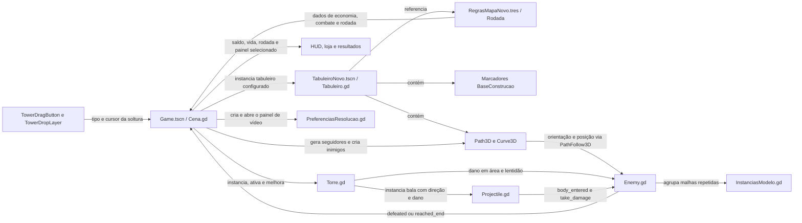
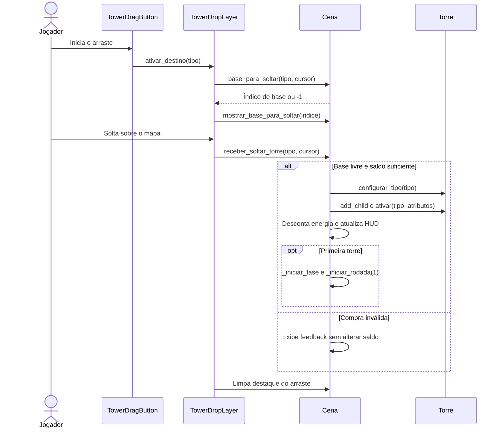
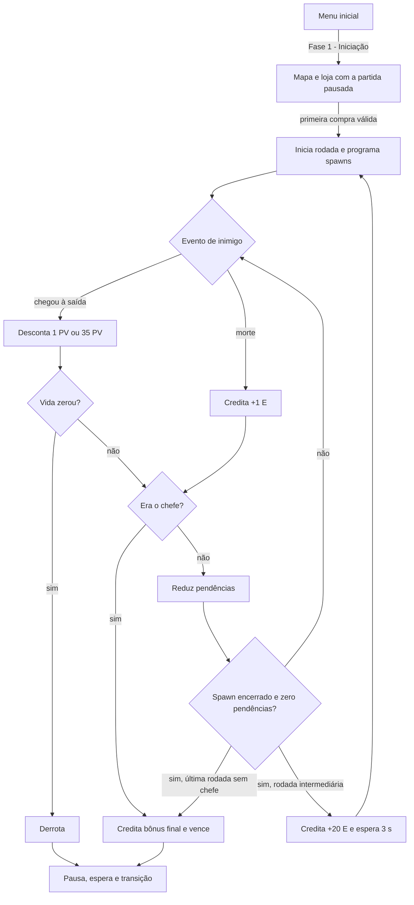

# ChargedFuss — relatório técnico e guia de estudo

Este relatório acompanha a versão atual de **ChargedFuss** em Godot 4.7 com GDScript. Ele usa a fase **Iniciação**, o tabuleiro oficial e os valores que chegam às instâncias em execução. Para localizar um valor, siga a ordem de aplicação descrita nas seções de código e balanceamento.

**Roteiro de leitura:** [1. Visão geral](#1-visão-geral-do-jogo) · [2. Código](#2-explicação-dos-códigos) · [3. Sistemas](#3-funcionamento-dos-sistemas) · [4. Exemplos](#4-exemplos-práticos-de-execução) · [5. Godot](#5-conceitos-do-godot) · [6. Manutenção](#6-guia-de-manutenção-e-expansão) · [7. Diagramas](#7-diagramas-e-fluxos)

## 1. Visão geral do jogo

**ChargedFuss** é um tower defense 3D. Em **Iniciação**, o jogador começa com **105 E** e **50 PV**, arrasta defesas para oito plataformas no mapa industrial e tenta impedir que os inimigos completem a rota. Há quatro tipos de torre, dez rodadas, um tipo de drone comum e um chefe no último spawn. A energia financia construções e melhorias. As fugas reduzem a vida.

O menu exibe **ChargedFuss**, enquanto `project.godot` ainda registra o nome interno **Tower-Defense**. O projeto carrega a cena principal por UID, que aponta para [Game.tscn](Game.tscn). Dentro dela, o nó raiz `Game` executa [Cena.gd](Cena.gd). O nome interno e o título visível são definidos em lugares diferentes.

### Organização dos arquivos

| Arquivo ou pasta | Papel |
|---|---|
| [project.godot](project.godot) | Ponto de entrada, resolução lógica, tema global, renderizador e física. |
| [Game.tscn](Game.tscn) e [Cena.gd](Cena.gd) | Cena principal, menus e controlador da partida. O campo `cena_tabuleiro` escolhe qual tabuleiro instanciar. O controlador administra energia, vida, construção, melhorias e rodadas. |
| [TabuleiroNovo.tscn](fases/iniciacao/TabuleiroNovo.tscn) e [Tabuleiro.gd](fases/Tabuleiro.gd) | O tabuleiro oficial agrupa o cenário GLB, a rota, as bases, a câmera, a luz, a colisão da estrada e a referência às regras. |
| [RegrasMapaNovo.tres](fases/iniciacao/RegrasMapaNovo.tres), [RegrasFase.gd](fases/RegrasFase.gd) e [Rodada.gd](fases/Rodada.gd) | Resource de Iniciação e scripts que definem seus campos. Contêm economia, ajustes das torres, mensagens e uma lista ordenada de rodadas. |
| [BaseConstrucao.gd](fases/BaseConstrucao.gd) | Script dos `Marker3D` que definem tamanho da área de soltura, altura da torre, indicador e tipo inicial opcional. |
| [TabuleiroOriginal.tscn](fases/iniciacao/TabuleiroOriginal.tscn) e [Regras.tres](fases/iniciacao/Regras.tres) | Backup do mapa antigo, com seis bases e seus próprios parâmetros. |
| [TorreBasica.tscn](TorreBasica.tscn) e [Torre.gd](Torre.gd) | Cena usada para instanciar **todos os quatro tipos**. O script monta a aparência e ativa o comportamento solicitado. |
| [Enemy.tscn](Enemy.tscn) e [Enemy.gd](Enemy.gd) | Corpo, modelo, movimento, esteiras e vida dos inimigos. O chefe parte da mesma cena, recebe atributos especiais e troca de modelo. |
| [Projectile.tscn](Projectile.tscn) e [Projectile.gd](Projectile.gd) | Bala da torre normal e da rápida. Movimento, colisão, dano e remoção. |
| [TowerDragButton.gd](TowerDragButton.gd) e [TowerDropLayer.gd](TowerDropLayer.gd) | Origem e destino do arraste. Entregam ao controlador o tipo da torre e a posição da soltura. |
| [ui/](ui/) | Scripts do menu de abertura, linhas da loja e painel gráfico, tema e miniaturas. |
| [InstanciasModelo.gd](InstanciasModelo.gd) e [MetricaMapa.gd](MetricaMapa.gd) | Agrupamento de peças 3D repetidas e parâmetros de referência do mapa. |
| `modelos/`, `fonts/` e [OrbitronTheme.tres](OrbitronTheme.tres) | Modelos GLB, arquivos de trabalho e texturas, fontes Orbitron e tema global. As telas principais também aplicam [TemaInterface.tres](ui/TemaInterface.tres). |
| [TorreRapida.tscn](TorreRapida.tscn), [TorreRapida.gd](TorreRapida.gd), [inimigo2.gd](inimigo2.gd) e [node_2d.tscn](node_2d.tscn) | Recursos fora do fluxo principal observado. A compra da rápida usa `TorreBasica.tscn`, e as rodadas usam `Enemy.tscn`. |

### Como a árvore se organiza em execução

```text
Game (Cena.gd)
├─ TabuleiroNovo (Tabuleiro.gd)
│  ├─ Cenario: instância de modelos/map.glb
│  ├─ ColisaoEstrada (StaticBody3D)
│  ├─ Camera3D, WorldEnvironment, DirectionalLight3D
│  ├─ Path3D com Curve3D
│  │  └─ PathFollow3D por inimigo
│  │     └─ Enemy (Enemy.gd)
│  └─ Bases com oito Marker3D
│     └─ Torre (Torre.gd) em cada base ocupada
├─ Projectile em voo
└─ HUD (CanvasLayer)
   ├─ MenuInicial
   ├─ Vida e Operacao
   ├─ MenuTorres, camada de soltura e preferências
   └─ TelaVitoria e TelaDerrota
```

A cena é um molde. Instanciar `Enemy.tscn` cria um inimigo com vida e posição próprias, mas suas malhas e materiais importados podem ser compartilhados. Um nó é uma peça da árvore. Um recurso é um dado que o nó usa, como uma curva, textura, material ou cena empacotada.

### Da abertura ao fim da partida

1. `Cena._ready()` coloca o jogo em pausa e desativa temporariamente a renderização 3D. `_carregar_tabuleiro()` instancia a cena configurada, valida a curva, a câmera, as bases e as regras, e inicializa o estado da partida. A interface recebe seus sinais e o HUD continua processando durante a pausa.
2. Clicar em **Fase 1 - Iniciação** chama `_on_menu_play_pressed()`. O menu inicial some, o mapa aparece e a loja abre. O jogo ainda está pausado.
3. A primeira compra válida chama `_iniciar_fase()`. A loja fecha, os controles de partida aparecem, a pausa termina e a rodada 1 começa.
4. A fase cria inimigos em intervalos. As torres atacam sozinhas. O controlador recebe eventos de eliminação e escape, atualiza energia e vida e avança a rodada quando ela está resolvida.
5. Com a vida zerada, há derrota. Resolver o chefe com o jogador vivo encerra a fase com vitória. A cena pausa e exibe o resultado. A derrota permite reiniciar a cena. O botão **Continuar** da vitória está desabilitado.

## 2. Explicação dos códigos

### `Cena.gd` — estado e coordenação

A cena é a fonte de verdade do saldo, da vida e da rodada. Uma torre conhece o próprio dano, mas não sabe quanto o jogador pagou por ela. Um inimigo conhece sua vida e emite sinais sobre seu destino. Essa separação permite ajustar uma torre sem reescrever o HUD ou as regras de vitória.

| Estado | Como interpretar |
|---|---|
| `player_energy`, `player_health` | Valores alterados por compras e resultados dos inimigos. O HUD apenas os apresenta. |
| `bases`, `torres`, `tipos_ativados`, `upgrades_comprados` | Coleções paralelas. No índice 2 ficam a terceira base, a torre instalada nela, seu tipo e as melhorias adquiridas. `torres[2] == null` significa base livre. |
| `TOWER_TYPES`, `TOWER_NAMES`, `ICONES_TORRES` | Catálogo compartilhado. Uma chave como `"tesla"` liga o tipo ao texto, ao ícone e ao comportamento. Os custos e ajustes da fase vêm de `regras`. |
| `UPGRADE_NAMES` e `regras.custos_upgrades` | O controlador conhece os nomes das melhorias. `_mostrar_upgrades()` escolhe as duas do tipo selecionado. O Resource define seus preços. |
| `partida_iniciada`, `fase_encerrada`, `rodada_atual` | Estado do fluxo. No menu inicial, a fase ainda não começou. A rodada é numerada a partir de 1, mas os arrays são indexados a partir de 0. |
| `inimigos_restantes`, `spawn_em_andamento`, `rodada_concluida` | Contagem e travas da rodada. O contador inclui os que ainda vão nascer. As travas evitam avançar cedo e premiar uma rodada duas vezes. |
| `revisao_fluxo_rodadas` | Identificador da sequência atual. Um timer que acorda depois de um salto de rodada ou do fim da fase confere se ainda pertence à sequência vigente. |
| `indice_torre_selecionada`, `torre_com_alcance_selecionada` | O primeiro identifica qual torre recebe a compra de melhoria. A segunda controla qual círculo de alcance está visível. São estados relacionados, com funções distintas. |

| Função | Entrada, retorno e papel |
|---|---|
| `_ready() -> void`, `_carregar_tabuleiro() -> bool` | Instanciam e validam o tabuleiro, tornam sua câmera ativa e dimensionam as listas de estado pela quantidade de marcadores. Se a configuração é inválida, o botão de início fica desabilitado. |
| `base_para_soltar(tipo: String, posicao_tela: Vector2) -> int` | Valida tipo, fase e saldo. Cruza o raio do cursor com a altura das bases livres e devolve o índice da interseção válida mais próxima da câmera ou `-1`. A prévia e a soltura chamam a mesma função. |
| `receber_soltar_torre(tipo, posicao_tela)`, `_comprar_torre(indice, tipo)` | Recebem o gesto e validam novamente a operação. A compra debita energia só após a instalação bem-sucedida. |
| `_instalar_torre(indice: int, tipo: String) -> bool` | Instancia a torre, calcula sua altura, liga o clique com o índice da base, aplica os atributos da fase e orienta o topo inicialmente para a rota. Serve também às torres iniciais opcionais, sem débito. |
| `_ao_clicar_torre(camera, evento, posicao, normal, indice_forma, indice) -> void` | Recebe o sinal de clique da colisão. O último argumento é anexado com `bind(indice)`, para identificar a base sem inferir sua posição pelo clique. |
| `_mostrar_upgrades(indice: int) -> void`, `_comprar_upgrade(indice_botao: int) -> void` | A primeira preenche título, imagem e botões e grava a chave da melhoria em metadados. A segunda lê essa chave, valida a compra e manda a torre aplicar o efeito. |
| `_iniciar_rodada(numero_rodada: int) -> void` | Seleciona dados da rodada e inicia um laço com `await` para espaçar os spawns. A execução volta ao motor durante cada espera. |
| `_on_enemy_defeated(eh_chefe: bool) -> void`, `_on_enemy_reached_end(eh_chefe: bool) -> void` | Recebem sinais e aplicam recompensa ou perda de vida. O booleano é fixado na conexão de cada inimigo. |
| `_resolver_inimigo() -> void`, `_verificar_fim_rodada() -> void`, `_aguardar_proxima_rodada(proxima_rodada: int) -> void` | Descontam um inimigo, verificam as travas da rodada e programam o próximo início após 3 s de jogo. |
| `_encerrar_fase(vitoria: bool) -> void`, `_mostrar_resultado(tela: Control, acao: String) -> void` | Encerram a simulação, pausam o jogo e mostram o resultado com foco na ação principal disponível. |
| `_configurar_camera() -> void` | Chama `Tabuleiro.enquadrar()` na abertura e ao mudar o tamanho do viewport. |
| `_alternar_pausa()`, `_recomecar_jogo()`, `_sair_do_jogo()` | Alternam a pausa e seus botões, recarregam a cena ou encerram o aplicativo. |

**Projeção do cursor.** O raio da câmera tem a forma `origem + direcao * t`. O cálculo em `base_para_soltar()` acha o ponto na altura da plataforma:

```gdscript
var profundidade := (altura - origem.y) / direcao.y
var ponto := origem + direcao * profundidade
var ponto_local := base.to_local(ponto)
```

A função descarta um raio quase paralelo ao plano ou uma interseção atrás da câmera. No tabuleiro novo ela compara o X/Z local com metade das dimensões do marcador. Isso acompanha o retângulo mesmo quando a plataforma está rotacionada. Se duas plataformas coincidirem na projeção, a profundidade vem primeiro. Em empate, vence o centro mais próximo. No backup, existe um plano comum de soltura e tolerância circular de **1,75 unidade**. As bases vazias são selecionadas por esse cálculo geométrico.

### Scripts que configuram uma fase

| Script | Como entra na partida |
|---|---|
| `Tabuleiro.gd` | `listar_bases() -> Array[BaseConstrucao]` filtra os filhos de `container_bases` pelo script do marcador. `enquadrar(tela, bases)` projeta os pontos úteis no plano da câmera e calcula posição e tamanho ortográfico. `criar_visual_do_caminho()` gera uma faixa auxiliar quando `largura_faixa > 0`, como no backup. O mapa novo já traz a faixa no GLB. |
| `BaseConstrucao.gd` | `dimensoes` define o retângulo em X/Z. `tolerancia_soltar` positiva usa raio. `tipo_inicial` pode indicar uma torre pré-instalada. `altura_torre` é a altura padrão de instalação e `altura_indicador` posiciona o anel a partir do marcador. |
| `RegrasFase.gd` | Os campos exportados definem valores iniciais, recompensas, dano de fuga, custos, ajustes de ataque, textos e `rodadas: Array[Rodada]`. O Resource é lido pelo controlador e o estado mutável da partida fica em `Cena.gd`. |
| `Rodada.gd` | Cada registro agrupa `quantidade`, `vida`, `velocidade`, `intervalo`, `tutorial` e `tem_chefe`. Campos omitidos no arquivo de dados usam os valores padrão do script. Por exemplo, a rodada 4 herda o intervalo de **1,8 s**. |

### `Torre.gd` — comportamento, aparência e alcance

O estado principal é `tipo_torre`, `active`, `shot_range`, `shot_interval`, `damage`, `shot_timer` e `balas_por_disparo`. `shot_interval` é a duração configurada entre ataques. `shot_timer` é a contagem regressiva que muda a cada tick. `modelo_melhorado` controla a troca de visual. As melhorias já compradas ficam em `Cena.gd`.

| Função | Entrada, retorno e papel |
|---|---|
| `configurar_tipo(tipo: String) -> void`, `_ready() -> void` | O tipo é definido **antes** de a torre entrar na árvore. Assim, `_ready()` já sabe qual visual montar. O processamento físico começa desativado. |
| `ativar(tipo: String, atributos: Dictionary = {}) -> void` | Aplica os padrões do tipo e depois as substituições da fase, prepara o círculo e habilita o processamento físico. |
| `definir_direcao_setor(direcao: Vector3) -> void` | Ajusta a direção inicial e a direção de referência do visual. Apesar do nome, a validação de alcance atual é circular, sem filtro de ângulo. |
| `_physics_process(delta: float) -> void` | Desconta o tempo, decide se é um ataque em área ou com mira e dispara quando as condições são atendidas. |
| `_encontrar_alvo_no_alcance() -> Node3D` | Devolve o inimigo no alcance com maior progresso no percurso, ou `null`. Para essa busca, o inimigo deve ter um `PathFollow3D` como pai. |
| `_inimigos_na_area() -> Array[Node3D]` | Devolve todos os membros 3D do grupo de inimigos dentro do raio horizontal. É usada pela Tesla e pelo lança-chamas. |
| `_atirar_no_alvo(target: Node3D) -> void` | Cria as balas, injeta dano e atirador e calcula as direções, usando `PontoDisparo` quando existe. |
| `aplicar_upgrade(tipo_upgrade: String) -> void` | Altera a propriedade de combate e aciona a mudança visual adequada. O controlador valida o preço e evita a compra duplicada. |
| `_preparar_modelo_torre()`, `_substituir_modelo_por_upgrade()` | Criam ou refazem o pivô e o ponto de disparo das torretas. As peças com nomes que contêm `gun` ou `baseturret` passam para o pivô mantendo a transformação global. |
| `_preparar_modelo_tesla(melhorado: bool)`, `_preparar_modelo_chamas(melhorado: bool)` | Escolhem o GLB inicial ou evoluído. O lança-chamas separa as malhas `Turret*` em um pivô e reposiciona o bocal ao trocar de modelo. |
| `_criar_visual_de_alcance()`, `_atualizar_visual_de_alcance()` | Geram a malha do anel. A atualização guarda a visibilidade antiga quando recria o indicador. A malha é decorativa. |

**Padrão e substituição.** `Torre.ativar()` aplica os padrões do tipo. Em seguida, usa as chaves de `regras.atributos_torres` presentes para aquele tipo, e a melhoria modifica o valor resultante. Na Tesla, Iniciação fornece `{"shot_range": 6.3, "damage": 5}`. O intervalo de **0,8 s** vem do padrão de `ativar()`. Procure primeiro essa cadeia quando uma edição no Inspetor parecer não surtir efeito.

Para a normal, `dano_normal_configurado` começa em 0 e copia `damage` em `_ready()`. Os **35 PV** vêm de `@export var damage` em `Torre.gd`, pois `TorreBasica.tscn` usa esse padrão. A fase define só seu alcance, em **6,1**. Para mudar os 35 PV apenas em Iniciação, acrescente a chave `"damage"` à entrada `"basica"` em `RegrasMapaNovo.tres`.

**Seleção e mira.** A comparação usa a distância ao quadrado para evitar uma raiz quadrada por candidato. Para raio 6,1, o limite quadrado é **37,21**. Entre os candidatos aceitos vence o maior `path_follow.progress`. A rotação usa `wrapf` para lidar com a fronteira entre -π e π e `clampf` para limitar o passo. A torreta espera o erro ficar em até **3°** antes do tiro. O deslocamento de π/2 compensa a frente do modelo importado.

### `Enemy.gd` — simulação dos inimigos

| Função | Entrada, retorno e papel |
|---|---|
| `_ready()` | Registra o inimigo no grupo `inimigos`, guarda o pai `PathFollow3D` e prepara a aparência. O drone tem ajuste de escala e esteiras. O chefe agrupa as peças repetidas do próprio visual. |
| `configurar_como_chefe(multiplicador_vida: int = 5) -> void` | Marca `is_boss`, multiplica a vida já configurada pela rodada e troca a aparência para `boss3.glb`. Iniciação passa **3** explicitamente. Aproveita o carregamento em segundo plano. |
| `_physics_process(delta)` | Atualiza a duração da lentidão, calcula quanto pode avançar e incrementa `caminho.progress`. Ao atingir o fim, emite `reached_end` e remove o inimigo. |
| `_preparar_esteiras() -> void` | Calcula comprimentos e direções do circuito local. Encontra as peças da esteira pelo nome e pelas dimensões e associa as elegíveis a lotes. |
| `_projetar_no_percurso(posicao: Vector2) -> float` | Descobre em que ponto do circuito uma peça se encaixa, projetando-a em cada segmento e escolhendo a projeção mais próxima. |
| `_amostrar_percurso(progresso: float) -> Vector4` | Encontra a posição e direção locais, acumuladas num vetor de quatro componentes. Usa resto positivo para voltar ao começo do circuito. |
| `_atualizar_esteiras(distancia: float) -> void` | Avança a animação pela distância real percorrida, calcula a orientação de cada elo e atualiza a instância no lote ou o nó individual. |
| `aplicar_lentidao(multiplicador: float, duracao: float) -> void` | Mantém a lentidão mais forte e a duração mais longa entre o efeito ativo e o recebido. Pulsos iguais renovam o efeito. |
| `take_damage(amount: int) -> void`, `_remover_do_percurso() -> void` | Descontam vida, emitem `defeated` uma vez e removem o pai temporário quando ele pertence apenas a esse inimigo. `death_processed` evita resolver o mesmo inimigo duas vezes. |

O `CharacterBody3D` fornece a forma detectável, mas o movimento normal vem do pai. A distância no tick é aproximadamente `speed * multiplicador_lentidao * delta`, limitada ao que resta da curva. No trecho de movimento, não há `move_and_slide()` e o valor exportado `gravity` não é usado. A esteira é outra curva, local ao modelo, e não interfere no progresso pelo mapa.

### Demais scripts

| Script | Responsabilidades, entradas e saídas |
|---|---|
| `Projectile.gd` | `_ready()` conecta `body_entered`. `_physics_process(delta)` move na direção inicial a 20 unidades/s e reduz a vida útil de 3 s. `_on_body_entered(body)` ignora a torre que o disparou, aplica `take_damage(damage)` se o corpo pertence a `inimigos` e agenda a remoção ao acertar. Recebe `direction`, `shooter` e `damage` da torre. |
| `TowerDragButton.gd` | Herda de `LinhaDefesa.gd`. `_get_drag_data(posicao: Vector2) -> Variant` devolve `{"tipo_torre": tipo_torre}` quando habilitado e com camada válida, ou `null`. Mostra miniatura de 48 px e ativa a camada de soltura. |
| `TowerDropLayer.gd` | `ativar_destino(tipo)` liga o processamento da prévia e ajusta o filtro de mouse. `_can_drop_data(posicao, dados) -> bool` converte a posição para o viewport e valida os dados e a região fora da loja. `_drop_data(posicao, dados)` encaminha a compra. `encerrar_destino()` e a notificação de fim de arraste limpam o destaque e desligam o processamento. |
| `ui/LinhaDefesa.gd` | `montar(icone_defesa: Texture2D = null)` cria uma linha com opção de ícone, nome e preço. `atualizar(nome, preco, indisponivel)` formata acessibilidade e disponibilidade, com retorno antecipado se nada mudou. A função estática `criar_imagem(textura, tamanho) -> TextureRect` monta a imagem reaproveitada pelo catálogo, pelas melhorias e pelo arraste. |
| `ui/MenuInicial.gd` | `_input(evento: InputEvent)` revela e foca o botão Gráficos ao detectar Ç enquanto o menu estiver visível. Examina o caractere Unicode para lidar com ç e Ç, ignora repetição automática e certas teclas modificadoras. O atalho não é o mesmo evento que abre o painel. |
| `ui/PreferenciasResolucao.gd` | `abrir(origem: Control, mostrar_qualidade: bool = false)` decide se mostra só resolução ou também o perfil. `_suportada(indice) -> bool` verifica o monitor. `_demonstrar()`, `_confirmar()`, `_reverter()` e `_salvar()` controlam prévia e persistência. `_aplicar_perfil()` ajusta escala, MSAA e sombras. A referência da origem serve para devolver o foco quando o painel fecha. |
| `InstanciasModelo.gd` | `agrupar(modelo: Node3D, animadas: Dictionary) -> Dictionary` identifica peças elegíveis com geometria idêntica e mesmo material, modo de sombra, camadas, orientação e categoria de animação. A partir de três peças por grupo cria um `MultiMesh`, esconde os nós originais e devolve um mapa de peças animadas para pares `[lote, índice]`. No Forward+ retorna um dicionário vazio. |
| `MetricaMapa.gd` | Define a referência de altura **23** usada como piso do zoom automático em `Tabuleiro.gd`. Os métodos de tamanho calculam dimensões teóricas com 22% reservados. O enquadramento atual usa as margens da cena do tabuleiro. A faixa auxiliar do backup declara **1,785** na própria cena. |
| `TorreRapida.gd` | Apenas herda `Torre.gd`. Não redefine o comportamento. Instanciar `TorreRapida.tscn` isoladamente não reproduz a sequência de configuração e ativação da loja. |
| `inimigo2.gd` | Protótipo que se desloca com `move_and_slide()`, aplica gravidade, procura o membro mais próximo de `inimigos` exceto a si mesmo e dispara. `take_damage(amount)` imprime dano e remove o nó a zero de vida. Não emite os sinais esperados pelo sistema de rodadas atual e não está conectado às cenas da fase. |

## 3. Funcionamento dos sistemas

### Economia, instalação e melhorias

| Fonte ou gasto | Regra atual |
|---|---|
| Saldo inicial | **105 E** a cada partida de Iniciação. |
| Eliminação | **+1 E** por inimigo derrotado, inclusive o chefe. |
| Rodada resolvida | **+20 E**. O final da fase também paga esse bônus se for uma vitória. |
| Inimigo que escapa | Sem recompensa. Desconta vida do jogador. |
| Construção e melhoria | Descontam o preço exibido. A fase não tem venda, reembolso nem renda passiva. |
| Atalho de teste | `C`, `G`, `T` em sequência concedem **+1.000 E**. |

A fase começa com **oito bases vazias**. A ordem dos marcadores em `TabuleiroNovo/Bases` determina os índices de compra, começando em 0. A loja oferece os mesmos quatro tipos para qualquer base. A prévia desenha os cantos conforme as dimensões e a rotação do marcador. Ao mover uma plataforma no Blender, alinhe também o marcador do Godot para que a torre e o destaque continuem encaixados.

| Base, na ordem do editor | X | Z | Lado |
|---|---:|---:|---:|
| `Base_Platform1` | 10,340 | −29,706 | 3,197 |
| `Base_Cube_002` | 12,326 | −12,290 | 3,197 |
| `Base_Cube_007` | 1,785 | −12,367 | 3,197 |
| `Base_Cube_012` | −8,833 | −20,158 | 3,197 |
| `Base_Cube_014` | 9,041 | 12,077 | 3,197 |
| `Base_Cube_015` | −10,235 | 5,589 | 2,967 |
| `Base_Cube_018` | −16,881 | −29,548 | 2,967 |
| `Base_Cube_021` | −8,708 | −32,069 | 2,967 |

O topo dos marcadores fica em **Y ≈ 0,185**. A raiz da torre sobe em relação a ele para compensar o pivô da arte. O deslocamento é **1,12** para Normal e Rápida, **1,00** para Tesla e **0,88** para Lança-chamas. A plataforma afastada `Base_Cube_012` fica a cerca de **7,49 unidades** do eixo da rota. A melhoria de alcance da Normal ou da Tesla habilita cobertura ali. [TabuleiroNovo.tscn](fases/iniciacao/TabuleiroNovo.tscn) · [Medições de cobertura](RESULTADO_BALANCEAMENTO_MAPA.md)

Uma melhoria pertence à instância selecionada. A tela consulta as duas opções associadas ao seu tipo. Uma compra bem-sucedida atualiza o atributo, desconta energia e atualiza preços, estado dos botões e círculo de alcance. Uma melhoria já aplicada não pode ser comprada de novo. As duas opções de cada torre podem coexistir.

### Combate e atributos das torres

| Defesa (chave) | Custo | Alcance horizontal | Intervalo | Dano e comportamento |
|---|---:|---:|---:|---|
| Normal ou básica (`basica`) | 60 E | 6,10 | 0,80 s | 35 PV por projétil. |
| Rápida (`rapida`) | 65 E | 5,60 | 0,24 s | 8 PV por projétil. |
| Tesla (`tesla`) | 55 E | 6,30 | 0,80 s | 5 PV por alvo no pulso e movimento a 0,5× por 1,5 s. |
| Lança-chamas (`chama`) | 65 E | 5,50 | 0,25 s | 7 PV por alvo no cone em cada aplicação de dano. |

| Defesa | Opção 1 | Opção 2 | Feedback no modelo ao melhorar |
|---|---|---|---|
| Normal | Mais dano, **45 E**, passa a **53** por acerto (`roundi(35 * 1.5)`). | Mais alcance, **42 E**, raio **9,15**. | Troca para `TurretUp.glb`, com escala do modelo melhorado de **1,35×**. |
| Rápida | Mais velocidade, **45 E**, intervalo de **0,16 s**. A cadência aumenta em 50% ao dividir o intervalo por 1,5. | Dobro de balas, **55 E**, dois projéteis de **8 PV** na mesma rajada. | Também troca para `TurretUp.glb`. Os detalhes laranja distinguem a variante. |
| Tesla | Pulso mais rápido, **45 E**, intervalo de **0,50 s**. | Mais alcance, **32 E**, raio **7,875**. | Troca para `Tesla2.glb` com fator adicional de escala de **1,25×**. |
| Lança-chamas | Mais dano, **40 E**, passa a **11 PV** por alvo. | Mais alcance, **32 E**, raio **6,875**. | Troca de `lancaChamas1.glb` para `lancaChamas2.glb` com fator adicional de **1,25×**. |

**Aquisição de alvo.** A normal e a rápida examinam o grupo `inimigos` quando podem atacar. Cada candidato é comparado ao raio em X/Z. Entre os candidatos, vence quem tem o maior avanço na curva. Imagine dois drones próximos da torre em trechos paralelos do S. A que passa no trecho mais adiantado pode ser escolhida mesmo estando um pouco mais longe no chão. Como o raio é circular, a direção inicial para a estrada serve à apresentação e não limita o ângulo de ataque. O círculo desenhado é uma indicação visual do mesmo raio usado no teste.

**Mira e projétil.** Com o ataque disponível, o topo gira em torno do pivô, com a base fixa, até ficar perto o suficiente da direção do alvo. A mira tem limite de **20 rad/s** e tolerância de **3°**. Se o alvo deixa a área antes do disparo, a busca seguinte refaz a escolha. O projétil recebe origem, direção e dano na hora de nascer, viaja em linha reta e depende da colisão para acertar. Na rápida melhorada, cada um dos dois projéteis tem sua própria origem lateral e direção em direção ao mesmo alvo. Se um inimigo desvia ou o projétil passa por outro inimigo, o resultado pode diferir da intenção inicial da torre. Um projétil sem acerto expira.

**Tesla.** `_executar_pulso_tesla()` busca todos os inimigos no círculo, aplica dano direto e chama `Enemy.aplicar_lentidao(0.5, 1.5)`. Pulsos repetidos renovam a duração. Um drone da rodada 1 passa de 5,8 para **2,9 un./s** durante o efeito. O raio desenhado pela torre dura **0,14 s** e é separado do dano.

**Lança-chamas.** A torre procura o alvo mais adiantado no círculo e gira o topo a **2,5 rad/s**. Depois do alinhamento inicial, mantém o jato enquanto houver alvo e atualiza a mira. A cada **0,25 s**, `_executar_pulso_chamas()` filtra os inimigos no raio pelo ângulo em relação ao bocal, usando produto escalar e semiângulo de **30°**. Cada alvo dentro do cone recebe dano naquele instante. A chama visível é contínua e o dano termina quando o inimigo sai da área.

### Caminho, inimigos e progressão

O `Path3D` de `TabuleiroNovo.tscn` contém uma `Curve3D` de cerca de **183,2 unidades** com **83 pontos de controle**. O início fica logo após a abertura da caixa preta e a chegada fica na borda da última reta, abaixo do enquadramento. A pista visível vem de `modelos/map.glb`, instanciado com escala **0,88×** e posição `Vector3(7.04, -10.55736, -13.2)`. O colisor estático da estrada usa a **camada 2**. A trajetória de cada inimigo vem de um `PathFollow3D` próprio, com repetição desabilitada e rotação no eixo Y. Ao editar a rota, alinhe a curva à arte da estrada no editor.

Em `Enemy.gd`, o deslocamento segue **avanço = velocidade × multiplicador de lentidão × delta**, limitado ao trecho restante. O inimigo herda a transformação do seguidor. O tabuleiro põe a raiz **0,055** unidade acima da curva e multiplica a escala visual padrão por **0,73** no drone e **0,66** no chefe. Esses fatores atuam nas malhas. A esteira usa sua própria curva local e converte a distância avançada para o espaço do modelo. A lentidão reduz também o avanço dos elos, atualizados como nós ou instâncias de um lote.

| Rodada | Drones comuns | PV por drone | Velocidade em un./s | Intervalo de spawn | Assunto do tutorial |
|---|---:|---:|---:|---:|---|
| 1 | 5 | 36 | 5,8 | 2,25 s | Posicionar a primeira defesa. |
| 2 | 7 | 38 | 6,0 | 2,05 s | Comparar a normal e a rápida. |
| 3 | 8 | 43 | 6,2 | 1,90 s | Ganhar energia por abate e por rodada. |
| 4 | 10 | 48 | 6,4 | 1,80 s | Conferir a plataforma que depende de alcance. |
| 5 | 11 | 54 | 6,5 | 1,75 s | Combinar Tesla e lança-chamas. |
| 6 | 12 | 58 | 6,7 | 1,65 s | Usar o painel durante a partida. |
| 7 | 13 | 64 | 6,9 | 1,60 s | Cobrir trechos diferentes. |
| 8 | 15 | 70 | 7,1 | 1,55 s | Acompanhar mais inimigos simultâneos. |
| 9 | 17 | 76 | 7,3 | 1,50 s | Preparar a defesa final. |
| 10 | 20 | 84 | 7,5 | 1,45 s | Enfrentar o chefe após o último drone. |

Os intervalos estão em **segundos de simulação**. A configuração prevê **118 drones comuns e um chefe**. O chefe herda a velocidade de **7,5 un./s** e tem **252 PV**, pois `84 × 3 = 252`. Uma normal com melhoria de dano causa 53 PV por acerto, suficientes para eliminar um drone até a rodada 4 em um tiro. Na rodada 5, os 54 PV já exigem outro acerto. Isso mostra como diferenças pequenas de vida mudam o número de tiros necessários.

**Tempo de percurso.** Divida o comprimento pela velocidade para estimar a travessia sem lentidão. São **31,6 s** para um drone da rodada 1 e **24,4 s** para um drone ou chefe da rodada 10. O intervalo de spawn determina quando o próximo inimigo entra. Na rodada 10, o chefe sai no vigésimo intervalo, cerca de **29 s** após o primeiro drone.

O controlador inicia a rodada com a contagem **total** de inimigos a resolver, inclusive os que ainda não nasceram. Um inimigo resolvido é um inimigo morto ou que chegou à saída. O avanço só é autorizado quando o spawn terminou e o contador chegou a zero. Há uma espera de **3 s de simulação** entre rodadas. A revisão do fluxo impede que uma espera pendente inicie outra rodada depois de um salto ou encerramento.

### Resultado da fase e atalhos

- **Vida inicial: 50 PV.** Cada drone comum que escapa causa **1 PV** de dano. O chefe causa **35 PV**. Uma eliminação não desconta vida.
- **Vitória:** eliminar o chefe ou sobreviver à passagem dele. O evento do chefe conclui a fase imediatamente, mesmo se alguma alteração de velocidade tiver deixado um drone para trás. Uma derrota anterior por vida zero encerra a partida antes.
- A resolução do chefe concede o bônus final de rodada quando há vitória. Se ele foi derrotado, a recompensa de eliminação também conta. Com **36 PV** antes do escape e sem outro evento, sobra **1 PV** e há vitória. Com **35 PV**, o saldo de vida chega a zero e há derrota.
- O fim congela a partida, invalida a sequência de spawn e passa a ignorar eventos tardios de eliminação e fuga. A tela aparece após **0,8 s reais** e entra com uma transição de **0,8 s reais**. A derrota permite reiniciar a cena ou sair. A vitória apresenta `Continuar` indisponível e `Sair`.
- **V** alterna 1×, 2× e 3× usando `Engine.time_scale`. **B** salta da rodada corrente para a 10 quando a fase está ativa e ainda não chegou nela. Limpa os seguidores atuais e não concede os bônus pulados. **C → G → T** é o atalho de energia. As interações são restringidas pelo fluxo de entrada e pelo estado da partida.

### Interface, tutorial e preferências

- **Abertura.** O menu e a partida estão em `Game.tscn`. O botão **Fase 1 - Iniciação** troca o estado visual sem carregar outra cena. **Ç** revela Gráficos enquanto esse menu está visível.
- **HUD.** A vida tem numeral e barra. O bloco do lado direito mostra saldo, ganhos, rodada, pausa e velocidade. Os ganhos de eliminações ocorridas na mesma janela de exibição são agregados. O bônus de rodada tem uma linha própria. Um timer de 1,8 s reinicia com cada ganho e limpa os acumuladores ao expirar. A cena atualiza valores nos eventos que os modificam, em vez de refazer todos os textos a cada frame.
- **Loja e tutorial.** A mesma placa mostra compra ou melhorias. As imagens da loja usam **96 px** e as linhas com imagem têm altura mínima de **112 px**. A prévia de arraste e a imagem do cabeçalho de melhorias usam **48 px**. As linhas sem imagem medem pelo menos **64 px**. Cada rodada fornece seu texto, separado do aviso de compra ou saldo insuficiente. Abrir a loja durante a partida mantém a simulação em andamento.
- **Seleção.** O clique na colisão da torre abre o painel de melhorias e mostra o círculo. Clicar outra vez na mesma torre esconde o círculo. Voltar à loja restaura o catálogo e fechar a loja esconde o painel. O realce do arraste tem estado próprio e é limpo ao terminar o gesto.
- **Tema e layout.** O projeto usa Orbitron. `Game.tscn` define contêineres, âncoras e estilos por variação de tema. `LinhaDefesa.gd` cria as linhas reaproveitadas. O HUD em `CanvasLayer` fica sobre o 3D e segue ativo quando a árvore está pausada.
- **Resolução.** A referência é **1600 × 900**, com stretch `canvas_items` e aspecto `expand`. As saídas oferecidas são **1280 × 720**, **1600 × 900** e **1920 × 1080**, conforme o monitor. A seleção inicial usa a maior opção suportada quando não há preferência aplicável. Uma saída igual à resolução do monitor usa tela cheia, e uma saída menor usa janela.
- **Pausa e preferências.** Pausar troca **Pausar** por **Retomar** e mostra **Resolução** e **Sair do jogo** à direita. O botão Sair chama `_sair_do_jogo()`. O menu inicial também oferece ajuste de qualidade pelo botão revelado com **Ç**. Uma alteração de resolução pode ser demonstrada por **12 s** antes de reverter. Confirmar salva perfil e resolução em `user://graficos.cfg`.

### Configuração gráfica e escolhas de desempenho

O renderizador do projeto é **Compatibility** (`gl_compatibility`, backend OpenGL), e os três perfis ajustam suas opções em execução. A coluna de escala 3D abaixo mostra o valor que o script solicita ao viewport. O layout da interface usa a referência lógica de **1600 × 900** e o tamanho de saída é configurado à parte.

| Perfil | Escala 3D | MSAA 3D | Sombras direcionais | Atlas |
|---|---:|---|---:|---:|
| Econômico | 75% | Desligado | 1 região, modo ortogonal | 2048 px |
| Equilibrado, padrão | 83,33% | 2× | 2 divisões | 2048 px |
| Alto | 100% | 4× | 4 divisões | 4096 px |

A câmera ortográfica usa o deslocamento `Vector3(24.74347, 19.83717, 48.56179)`, as margens lógicas `Vector4(418, 95, 30, 45)` na ordem esquerda, topo, direita e rodapé, e pontos extras no portal. A inclinação é de aproximadamente **20° para baixo**, de modo que as paredes preencham o fundo. A referência de tamanho ortográfico em 16:9 é **38,19** e os planos de corte são **0,25** e **240**. O ajuste automático usa o cenário e o espaço disponível na tela para posicionar a câmera. Para deixar a pista sair pela borda, o cálculo de enquadramento desconsidera as últimas **27 unidades**. Os seguidores percorrem toda a curva.

O tabuleiro configura uma luz direcional de energia **1,3**, sombras com distância máxima de **165 unidades** e ambiente de energia **0,3**. O projeto usa física **Jolt** e interpolação. A câmera e as instâncias recém-colocadas reiniciam a interpolação ao ajustar a transformação.

| Trabalho em execução | Como o código trata |
|---|---|
| Motores de esteira, peças repetidas | `InstanciasModelo.agrupar()` usa lotes `MultiMesh` para geometrias e materiais compatíveis. Um lote substitui os desenhos individuais, mas as malhas originais continuam como nós ocultos. O benefício depende de quantas superfícies podem ser agrupadas. |
| Carregamento do chefe | A partir da rodada 8, solicita o GLB em segundo plano. Há um caminho de carregamento direto se a solicitação ainda não foi feita. |
| Ataques por área | O nó visual e o timer do efeito são reaproveitados. O efeito visual é separado do dano. |
| Aquisição de alvos | Normal, Rápida e Tesla retornam cedo durante a recarga. O lança-chamas precisa continuar acompanhando o alvo para manter o jato orientado. O custo da busca cresce com a quantidade de candidatos e de torres que buscam no mesmo tick. |
| Instanciação e remoção | Inimigos e projéteis usam `instantiate()` e `queue_free()`. Não há pool geral para eles. Cada inimigo remove seu seguidor temporário quando ele fica sem uso. |
| Interface | Saldo, vida e opções são atualizados por eventos. A camada de soltura só processa a prévia durante um arraste ativo. |

Os relatórios registram os cenários e resultados medidos. Use as condições de cada teste para interpretar draw calls, tempo de simulação e pendências de FPS. [Integração](RESULTADO_INTEGRACAO_MAPA.md) · [Validação](RESULTADO_VALIDACAO_MAPA.md)

### Exportação Linux

A exportação mais recente foi **Linux x86-64 Release**, com PCK embutido e renderizador **Compatibility**. O arquivo `project.godot` usa `editor/export/convert_text_resources_to_binary=false`. Essa configuração foi aplicada após o teste Release encontrar instâncias GLB vazias com a conversão ativa. O processo de exportação atual inclui todos os recursos. Um filtro restrito apenas às cenas já deixou de incluir dependências como scripts, cenas e ícones carregados por código. O modelo do chefe também é carregado por caminho em execução. A inicialização do binário foi confirmada no Ubuntu via WSL sem janela.

O pacote local `.godot/export-linux/ChargedFuss-linux-x86_64.tar.gz` contém `ChargedFuss.x86_64` com permissão de execução no arquivo compactado. `.godot/` guarda arquivos locais e o pacote precisa ser gerado novamente para reproduzir a exportação em outra cópia do projeto.

### Áudio e outros limites da versão atual

Não há sistema de áudio da partida implementado no código ou nas cenas analisadas. Disparo, pulso, colocação e resultado já têm pontos claros de integração para futuros sons. Também não há torre econômica, segunda fase jogável ou salvamento do progresso da partida. As preferências gráficas são persistidas de forma independente.

## 4. Exemplos práticos de execução

### Comprar e posicionar uma normal com 105 E

1. Em `TowerDragButton.gd`, o Godot chama `_get_drag_data()`. O botão entrega `{"tipo_torre": "basica"}` e mostra a miniatura.
2. `TowerDropLayer.gd` atualiza a prévia chamando `Cena.base_para_soltar("basica", cursor)`. A câmera fornece o raio do cursor. Quando a interseção cai no retângulo de uma base livre, os cantos dela são destacados. Se duas bases estiverem sob o cursor, a que estiver mais perto da câmera tem prioridade.
3. Na soltura, `TowerDropLayer._drop_data()` encaminha os dados para `Cena.receber_soltar_torre()`. A cena verifica se a compra ainda cabe no saldo e se a base continua livre. Arrastar até um lugar inválido não cobra energia.
4. `Cena._comprar_torre()` chama `_instalar_torre()`, que instancia `TorreBasica.tscn`, chama `configurar_tipo("basica")` e adiciona a instância sob a base. Isso executa `Torre._ready()`. A cena liga o clique, chama `ativar()` com os parâmetros da fase e orienta o topo para a estrada.
5. O saldo fica em **45 E**. A instância ocupa `torres[indice]`. A primeira compra chama `_iniciar_fase()`, que despausa e aciona `_iniciar_rodada(1)`.

### Encontrar um alvo e eliminar um drone

1. `Torre._physics_process(delta)` verifica se a recarga expirou. Suponha que A esteja a 4 unidades horizontais com progresso 20, B esteja a 5 com progresso 24 e C esteja a 6,2 com progresso 28. Com raio 6,1, A e B entram no círculo. B está mais adiantado e é escolhido. C está fora do círculo.
2. A torre calcula o ângulo para B e gira o topo. Ao entrar na tolerância, `Torre._atirar_no_alvo(B)` cria um `Projectile` com direção inicial e dano de 35.
3. `Projectile._physics_process()` move a bala. Se o projétil colide com um drone da rodada 1 com 36 PV, `Projectile._on_body_entered()` chama `Enemy.take_damage(35)`. O drone ainda tem **1 PV**.
4. Um segundo acerto de 35 dispara `defeated` e remove o inimigo. O sinal chega a `Cena._on_enemy_defeated(false)`, que dá **+1 E** e chama `_resolver_inimigo()`.
5. Se o dano da normal foi melhorado antes do primeiro disparo, ela causa **53 PV** e elimina esse drone em um acerto. Cada bala guarda o dano que recebeu ao nascer.

### Melhorar o alcance

1. Ao clicar na torre, o `input_event` ligado durante a compra chama `Cena._ao_clicar_torre()` com o índice da base. A função exibe o anel e abre o painel.
2. `Cena._mostrar_upgrades()` monta as opções. O botão de alcance da normal guarda a chave correspondente. Pressionar o botão aciona `_comprar_upgrade()`, que consulta a chave, saldo e registro de aquisição.
3. Com 45 E, a compra de alcance por **42 E** deixa **3 E**. `Torre.aplicar_upgrade()` muda o raio de 6,1 para 9,15, recria o anel e aplica o visual `TurretUp` se for a primeira melhoria.
4. A cena registra a compra e atualiza o painel. O raio novo entra nos testes seguintes de alvo. Uma segunda melhoria, quando comprada, preserva a primeira.

### Renda durante a partida

Sem compras adicionais, uma normal seguida de cinco eliminações deixa o saldo em **45 E → 50 E**. O bônus da rodada eleva esse valor a **70 E**. `_mostrar_ganho_energia()` exibe o ganho e `_atualizar_economia()` atualiza saldo e preços disponíveis. Se um dos cinco drones escapar e a rodada for concluída, o saldo final será **69 E** e o jogador ficará com **49 PV**.

### Da última eliminação de uma rodada ao primeiro spawn da próxima

1. `_iniciar_rodada(1)` lê o primeiro registro em `regras.rodadas`, atualiza o HUD e registra cinco pendências. Nasce o primeiro drone e o script aguarda **2,25 s de jogo** entre os nascimentos.
2. O quinto nascimento apenas termina o spawn. A rodada pode continuar com inimigos vivos.
3. Cada morte ou fuga de drone reduz o contador por `_resolver_inimigo()`. Quando o contador chega a zero e o spawn terminou, `_verificar_fim_rodada()` paga **20 E**.
4. `_aguardar_proxima_rodada(2)` espera 3 s de jogo e confere a revisão do fluxo. Se a partida ainda permite avançar, chama `_iniciar_rodada(2)`. O HUD e a instrução mudam, e o primeiro drone da nova rodada já é criado.

### Vencer, perder e reiniciar

| Evento real | Caminho no código |
|---|---|
| Chefe eliminado | `Enemy.take_damage()` → `defeated` → `Cena._on_enemy_defeated(true)` (+1 E) → `_vencer_nivel_pelo_chefe()` (+20 E) → `_encerrar_fase(true)`. |
| Chefe escapa com 36 PV de jogador | `Enemy._physics_process()` → `reached_end` → `Cena._on_enemy_reached_end(true)` (sobra 1 PV) → `_vencer_nivel_pelo_chefe()` → vitória. |
| Chefe escapa com 35 PV, ou drone comum escapa com 1 PV | `Cena._on_enemy_reached_end()` baixa a vida até zero, atualiza o HUD e chama `_encerrar_fase(false)` antes de qualquer verificação de vitória ou bônus. |
| Reiniciar na derrota | O botão chama `Cena._recomecar_jogo()`. A recarga da cena inicia outra instância de `Game` com as bases vazias e o estado inicial. As preferências de vídeo carregam do arquivo de configuração. |
| Sair durante a pausa | `Cena._alternar_pausa()` pausa a árvore e exibe **Sair do jogo**. O HUD processa o clique mesmo com a simulação parada. O botão chama `Cena._sair_do_jogo()`, que encerra o aplicativo com `get_tree().quit()`. |

## 5. Conceitos do Godot

| Conceito | Onde aparece e como interpretar |
|---|---|
| **Nó e hierarquia** | Uma árvore expressa composição e propriedade. `PathFollow3D` fornece a transformação do filho `Enemy`; a base faz o mesmo para a torre. `position` é local ao pai e `global_position` é no referencial da cena. |
| **Cena e `PackedScene`** | `preload("res://Enemy.tscn")` guarda um recurso de cena. `instantiate()` cria os nós em memória e `add_child()` os conecta à árvore. Por isso `Cena` consegue escrever vida e velocidade antes de o inimigo executar `_ready()`. |
| **Recursos compartilhados** | `Curve3D`, fontes, texturas, materiais e malhas são dados. Dois nós podem referenciar o mesmo material. Em `_colorir_detalhes_torre()`, duplicar o material antes de editar evita que o azul de uma instância apareça também na rápida. |
| **Sinais e `bind`** | Sinal é uma notificação. O emissor de `defeated` não precisa conhecer a contabilidade da fase. `_on_enemy_defeated.bind(eh_chefe)` acrescenta um dado à chamada do receptor. Um botão também usa sinal, como `pressed`. |
| **`_ready()`, `@onready` e `@export`** | `_ready()` executa quando a hierarquia da instância está disponível. `@onready` resolve referências a nós nessa etapa. `@export` expõe valores no Inspetor, mas um carregador como `_iniciar_rodada()` pode sobrescrevê-los em execução. |
| **`_process(delta)` e `_physics_process(delta)`** | A prévia do cursor roda por frame da interface. Inimigos, torres e balas avançam em ticks físicos. `delta` indica o tempo simulado desde a última chamada. Usá-lo torna uma velocidade expressa por segundo, em vez de depender diretamente da quantidade de chamadas. |
| **Curvas e seguidores** | `Path3D` guarda a rota e `PathFollow3D` interpreta `progress` em distância sobre a curva. É o equivalente a uma fita métrica dobrada sobre a estrada. O código movimenta um drone aumentando a medida, sem procurar o próximo ponto com navegação. |
| **Grupos e colisão** | `inimigos` é uma categoria de nós pesquisável, usada na escolha de alvo. `Area3D` do projétil tenta detectar corpos nas camadas da máscara física. `body_entered` sinaliza o contato e a regra consulta o grupo para decidir se deve causar dano. Um grupo não substitui uma forma de colisão. |
| **Ray picking e projeção** | Um clique numa torre selecionável pode ser entregue pelo sinal físico `input_event`. O arraste cruza o raio da câmera com o plano na altura de cada base e verifica a área no referencial local dela. São duas maneiras de interpretar um cursor 2D num mundo 3D. |
| **`Control` e arraste** | O Godot chama `_get_drag_data()`, `_can_drop_data()` e `_drop_data()`. Quem inicia o arraste empacota o tipo. Quem recebe encaminha o gesto. Quem compra é o controlador da fase. |
| **Timer, `await` e pausa** | O spawn aguarda `create_timer(..., false).timeout`, sem travar a execução da árvore. O `false` faz a espera acompanhar a pausa do jogo. Os resultados usam tempo real para aparecer mesmo com a árvore pausada. |
| **Interpolação de física** | O motor usa estados físicos adjacentes para suavizar a imagem entre ticks. Ela não altera a regra de alcance nem a distância simulada. Resetar a interpolação depois de um posicionamento instantâneo evita uma transição visual desde uma posição antiga. |
| **`queue_free()`** | Agenda a remoção ao fim do frame. Nesse intervalo o objeto ainda pode existir e receber outra notificação. `death_processed` impede que um drone dê energia ou cause fuga duas vezes. |

Trecho de [Cena.gd](Cena.gd) ao criar um inimigo, com as mesmas chamadas usadas na fase:

```gdscript
enemy.connect("reached_end", _on_enemy_reached_end.bind(eh_chefe))
enemy.connect("defeated", _on_enemy_defeated.bind(eh_chefe))
path_follow.add_child(enemy)
path_follow.reset_physics_interpolation()
```

As conexões vêm antes de inserir a instância na árvore. Isso separa três responsabilidades: o inimigo emite o que ocorreu, a conexão identifica se ele é o chefe e o controlador decide o efeito na vida, na energia e nas rodadas.

## 6. Guia de manutenção e expansão

### Adicionar uma torre

1. Em [Cena.gd](Cena.gd), registre a chave em `TOWER_TYPES`, `TOWER_NAMES` e `ICONES_TORRES`. A loja percorre o catálogo. O carregador exige um preço em `custos_torres` para cada chave do catálogo, inclusive para abrir o tabuleiro de backup. Use `atributos_torres` para ajustes opcionais por fase.
2. Em [Torre.gd](Torre.gd), ligue a chave ao carregamento do modelo e a seus valores padrão em `ativar()`. O fluxo atual instancia `TorreBasica.tscn` para todos os tipos, define o tipo antes de `_ready()` e passa os ajustes da fase na ativação.
3. Implemente o comportamento no ponto apropriado. Uma torre de área pode reaproveitar `_inimigos_na_area()`. Para um novo tipo de projétil, mantenha o contrato de origem, direção, dano e sinal de colisão.
4. Se houver melhorias, cadastre os nomes em `UPGRADE_NAMES`, vincule as duas chaves ao tipo em `Cena._mostrar_upgrades()` e configure os preços em `custos_upgrades` no Resource da fase. Implemente os efeitos em `Torre.aplicar_upgrade()`. No modelo com cano móvel, confira o pivô, o eixo frontal e `PontoDisparo`.
5. Exercite a torre como primeira compra, em base ocupada, com saldo insuficiente, nas duas melhorias e após pausar. Compare raio efetivo e raio mostrado.

Para uma **torre econômica futura**, deixe a torre gerir quando o ciclo vence, e deixe `Cena.gd` gerir o saldo. Ela pode emitir um sinal com a quantidade positiva ao vencer um timer que respeita a pausa, com conexão feita na compra. A cena credita a energia e reutiliza a atualização do saldo. Se a origem precisar aparecer no HUD, faça um tratamento distinto de eliminação e bônus de rodada. Nenhuma dessas peças de renda recorrente existe hoje.

### Criar um inimigo

1. Para uma diferença só de vida e velocidade, use `Enemy.tscn` e configure os valores antes de `add_child()`, como já ocorre por rodada. Para tipos misturados, troque a regra de seleção dentro do laço de spawn por uma lista que informe o tipo de cada entrada.
2. Para outro modelo, importe o GLB e ajuste escala, altura, orientação e forma de colisão na cena ou em função de preparação. A forma de colisão é independente da geometria visível. O grupo `inimigos` e `take_damage()` são necessários para as armas existentes.
3. Preserve `reached_end` e `defeated`. Se o novo inimigo gerar dano de fuga diferente, amplie os dados que o spawn associa à conexão. Hoje o booleano `eh_chefe` basta para os dois valores.
4. Para outra esteira, confira os nomes e limites usados por `_coletar_segmentos_esteira()` e o circuito de `_preparar_esteiras()`. Um modelo pode andar sem esteiras, mas ainda precisa ficar com a frente alinhada à curva.

### Criar outra fase

O projeto já separa o tabuleiro e suas regras da lógica geral. `Game.tscn` aponta para a fase oficial pelo campo `cena_tabuleiro`. É possível testar outra configuração trocando essa referência no Inspetor.

1. Crie uma cena com `Tabuleiro.gd`. Instancie o modelo visual e configure os campos exportados para câmera, luz, rota e bases. Use os dois tabuleiros de Iniciação como exemplos.
2. Crie um `Path3D` com uma `Curve3D` aberta. O primeiro e o último ponto definem spawn e chegada. Alinhe os pontos intermediários à pista e ajuste a altura dos inimigos e o colisor estático junto com a geometria.
3. Crie um `Marker3D` com `BaseConstrucao.gd` por plataforma e configure as dimensões, orientação e offsets. A quantidade vem dos filhos reconhecidos no contêiner. Preencha `tipo_inicial` apenas nas bases que começam ocupadas e combine com `iniciar_ao_entrar` se a rodada precisar começar sem uma compra.
4. Crie um Resource baseado em `RegrasFase.gd` e atribua-o a `regras`. Preencha títulos, economia, custos e as entradas de `rodadas`, cada uma com seu texto e seus atributos de inimigo. Para manter o fluxo de Iniciação, use `tem_chefe` na última rodada. Resolver esse chefe encerra a fase.
5. Configure o enquadramento no próprio tabuleiro. Confira a projeção dos marcadores com a loja aberta. Ajuste `deslocamento_camera`, margens ou pontos de enquadramento e preserve a rota de ponta a ponta.
6. Para disponibilizar várias fases na mesma versão, ligue a seleção do menu à cena de tabuleiro escolhida e defina para onde vai **Continuar**. Atualmente há uma fase jogável, e reiniciar recarrega a cena principal.

### Trocar números, tela ou mecânica

| Mudança | Comece por | Verificação prática |
|---|---|---|
| Preços, recompensas e saldo inicial | `custos_torres`, `custos_upgrades`, `energia_inicial`, `energia_por_eliminacao` e `bonus_rodada` no Resource da fase. | Compare o preço exibido com o débito aplicado e confira os botões ao mudar o saldo. |
| Dano, alcance e cadência das torres | `RegrasMapaNovo.tres` em `atributos_torres` para a fase oficial. Padrões em `Torre.ativar()` e efeitos de melhorias em `Torre.aplicar_upgrade()`. | Teste um alvo no limite do raio, no limiar de PV e após as duas melhorias, em ordens diferentes. |
| Composição, PV, velocidade e intervalo das rodadas | Cada sub-recurso `Rodada` em `RegrasMapaNovo.tres`. | Conte os spawns e confira o intervalo e a espera da próxima rodada. Confira a rodada final com e sem atalho. |
| Final da fase | `dano_fuga_chefe` e `multiplicador_vida_chefe` nas regras. Para mudar a lógica, procure `Cena._on_enemy_reached_end()`, `_on_enemy_defeated()` e `_vencer_nivel_pelo_chefe()`. | Confira a vitória com chefe morto, a vitória com 1 PV e a derrota no limiar exato. |
| HUD e telas | `Game.tscn`, `OrbitronTheme.tres`, `ui/TemaInterface.tres` e os caminhos `@onready` em `Cena.gd`. | Confira 720p, 900p e 1080p. Ao renomear o painel da loja, confira a referência que `Cena.gd` passa a `TowerDropLayer.gd`. |
| Novas linhas na loja | `_criar_interface_de_torres()`, `_mostrar_upgrades()` e `ui/LinhaDefesa.gd`. | As linhas são geradas pelo controlador. A soltura continua funcional e o texto tem contraste nos estados normal, focado e indisponível. |
| Som de disparo, compra e resultado | `Torre._atirar_no_alvo()`, os pulsos em `Torre.gd`, `Cena._comprar_torre()` e `Cena._mostrar_resultado()`. | Para uma implementação futura, reutilize poucos players e limite sons simultâneos durante rajadas. Teste se o som deve acompanhar pausa e aceleração. |
| Exportação com seleção de recursos | O modelo do chefe é carregado por caminho em `Enemy.gd`. | Se usar exportação seletiva, inclua `modelos/boss3.glb` e teste a rodada 10 no executável. |

Para uma nova mecânica, escolha primeiro **quem deve guardar o estado**. Dados de vida de um drone pertencem ao inimigo. Dados de uma torreta, à sua instância. Saldo e regras da rodada, ao controlador. Faça o evento chegar ao dono do estado antes de atualizar a interface. Isso evita que um botão altere diretamente atributos que também deveriam mudar se a mesma ação vier de outro lugar.

## 7. Diagramas e fluxos

### Dependências em execução



### Da soltura à compra



### Rodadas e resultado



