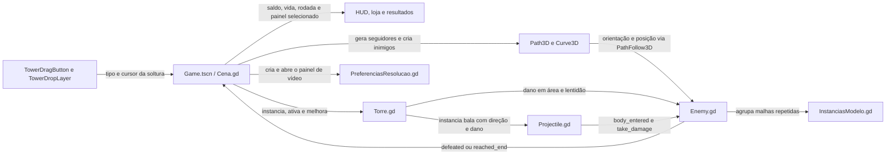
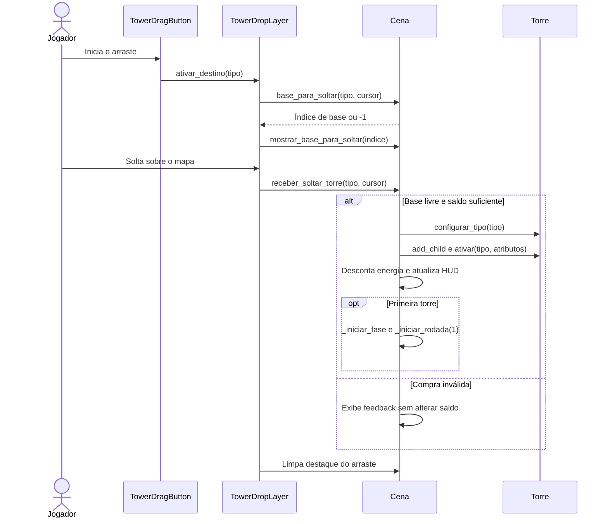
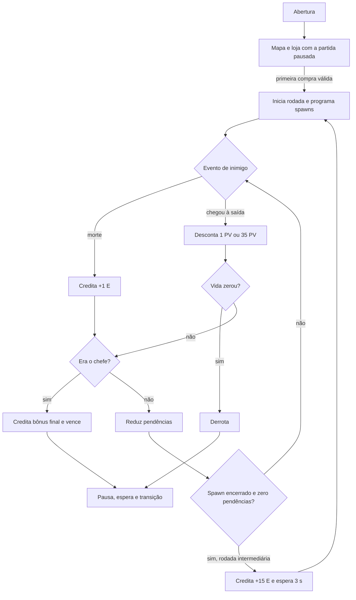

# ChargedFuss — relatório técnico e guia de estudo

Este relatório descreve a versão atual do projeto Godot 4.7, incluindo o código da fase **Iniciação** e os scripts que ficaram de protótipos. Os valores abaixo são os que o código aplica nessa fase. Sempre que houver diferença entre um valor padrão do script e o que acontece na partida, vale o caminho de execução descrito aqui.

**Roteiro de leitura:** [1. Visão geral](#1-visão-geral-do-jogo) · [2. Código](#2-explicação-dos-códigos) · [3. Sistemas](#3-funcionamento-dos-sistemas) · [4. Exemplos](#4-exemplos-práticos-de-execução) · [5. Godot](#5-conceitos-do-godot) · [6. Manutenção](#6-guia-de-manutenção-e-expansão) · [7. Diagramas](#7-diagramas-e-fluxos)

## 1. Visão geral do jogo

**ChargedFuss** é um tower defense 3D. O jogador começa com **100 E de energia** e **50 de vida**, arrasta torres para seis bases fixas e tenta defender uma rota em S. Há quatro torres, dez rodadas, drones comuns e um chefe na rodada final. A energia financia novas torres e melhorias. Os inimigos que escapam reduzem a vida.

O menu exibe **ChargedFuss**, enquanto `project.godot` ainda registra o nome interno **Tower-Defense**. O projeto carrega a cena principal por UID, que aponta para [Game.tscn](Game.tscn). Dentro dela, o nó raiz `Game` executa [Cena.gd](Cena.gd). O nome interno e o título visível são definidos em lugares diferentes.

### Organização dos arquivos

| Arquivo ou pasta | Papel |
|---|---|
| [project.godot](project.godot) | Ponto de entrada, resolução lógica, tema global, renderizador e física. |
| [Game.tscn](Game.tscn) e [Cena.gd](Cena.gd) | Cena principal e controlador da partida. Reúnem o tabuleiro, a câmera, o caminho, os menus, o HUD, a economia e as rodadas. |
| [TorreBasica.tscn](TorreBasica.tscn) e [Torre.gd](Torre.gd) | Cena usada para instanciar **todos os quatro tipos**. O script monta a aparência e ativa o comportamento solicitado. |
| [Enemy.tscn](Enemy.tscn) e [Enemy.gd](Enemy.gd) | Corpo, modelo, movimento, esteiras e vida dos inimigos. O chefe parte da mesma cena, recebe atributos especiais e troca de modelo. |
| [Projectile.tscn](Projectile.tscn) e [Projectile.gd](Projectile.gd) | Bala da torre normal e da rápida. Movimento, colisão, dano e remoção. |
| [TowerDragButton.gd](TowerDragButton.gd) e [TowerDropLayer.gd](TowerDropLayer.gd) | Origem e destino do arraste. Entregam ao controlador o tipo da torre e a posição da soltura. |
| [ui/](ui/) | Scripts do menu de abertura, linhas da loja e painel gráfico, tema e miniaturas. |
| [InstanciasModelo.gd](InstanciasModelo.gd) e [MetricaMapa.gd](MetricaMapa.gd) | Agrupamento de peças 3D repetidas e parâmetros de referência do mapa. |
| `modelos/`, `fonts/` e [OrbitronTheme.tres](OrbitronTheme.tres) | Modelos GLB, arquivos de trabalho e texturas, fontes Orbitron e tema global. As telas principais também aplicam [TemaInterface.tres](ui/TemaInterface.tres). |
| [TorreRapida.tscn](TorreRapida.tscn), [TorreRapida.gd](TorreRapida.gd), [inimigo2.gd](inimigo2.gd) e [node_2d.tscn](node_2d.tscn) | Recursos fora do fluxo principal observado. A compra da rápida usa `TorreBasica.tscn`, e as rodadas usam `Enemy.tscn`. |

### Como a árvore se organiza em execução

```text
Game (Cena.gd)
├─ Camera3D, WorldEnvironment, DirectionalLight3D
├─ Chão
│  └─ StaticBody3D: malha visível e forma de colisão
├─ Path3D: recurso Curve3D
│  ├─ VisualCaminho: faixa criada por Cena.gd
│  └─ PathFollow3D: um por inimigo criado
│     └─ Enemy (Enemy.gd): colisão e modelo do drone ou chefe
├─ BaseVazia: seis nós criados por Cena.gd
│  └─ Torre (Torre.gd): só existe depois da compra
├─ Projectile: filhos temporários da cena atual
└─ HUD (CanvasLayer)
   ├─ MenuInicial
   ├─ Vida e Operacao
   ├─ MenuTorres, camada de soltura e preferências
   └─ TelaVitoria e TelaDerrota
```

A cena é um molde. Instanciar `Enemy.tscn` cria um inimigo com vida e posição próprias, mas suas malhas e materiais importados podem ser compartilhados. Um nó é uma peça da árvore. Um recurso é um dado que o nó usa, como uma curva, textura, material ou cena empacotada.

### Da abertura ao fim da partida

1. `Cena._ready()` coloca o jogo em pausa, desativa a renderização 3D, monta bases e interface, liga os sinais dos botões, enquadra a câmera e verifica se há um caminho utilizável. O HUD continua processando durante a pausa.
2. Clicar em **Fase 1 - Iniciação** chama `_on_menu_play_pressed()`. O menu inicial some, o mapa aparece e a loja abre. O jogo ainda está pausado.
3. A primeira compra válida chama `_iniciar_fase()`. A loja fecha, os controles de partida aparecem, a pausa termina e a rodada 1 começa.
4. A fase cria inimigos em intervalos. As torres atacam sozinhas. O controlador recebe eventos de eliminação e escape, atualiza energia e vida e avança a rodada quando ela está resolvida.
5. Com a vida zerada, há derrota. Resolver o chefe com o jogador vivo encerra a fase com vitória. A cena pausa e exibe o resultado. A derrota permite reiniciar a cena. O botão **Continuar** da vitória está desabilitado.

## 2. Explicação dos códigos

### `Cena.gd` — estado e coordenação

A cena é a fonte de verdade do saldo, da vida e da rodada. Uma torre conhece o próprio dano, mas não sabe quanto o jogador pagou por ela. Um inimigo conhece sua vida e emite sinais sobre seu destino. Essa separação permite ajustar uma torre sem reescrever o HUD ou as regras de vitória.

| Estado | Como interpretar |
|---|---|
| `player_energy`, `player_health` | Valores alterados por compras e resultados dos inimigos. O HUD apenas os apresenta. |
| `bases`, `torres`, `tipos_ativados`, `upgrades_comprados` | Coleções paralelas. No índice 2 ficam a terceira base, a torre instalada nela, seu tipo e as melhorias adquiridas. `torres[2] == null` significa base livre. |
| `TOWER_TYPES`, `TOWER_COSTS`, `TOWER_NAMES`, `ICONES_TORRES`, `ATRIBUTOS_TORRES_INICIACAO` | Cadastro do catálogo. A chave interna, como `"tesla"`, conecta listas, preço, miniatura, nome e ajustes de combate. |
| `UPGRADE_COSTS`, `UPGRADE_NAMES` | Catálogo de melhorias. `_mostrar_upgrades()` determina quais duas chaves aparecem para cada tipo. |
| `partida_iniciada`, `fase_encerrada`, `rodada_atual` | Estado do fluxo. No menu inicial, a fase ainda não começou. A rodada é numerada a partir de 1, mas os arrays são indexados a partir de 0. |
| `inimigos_restantes`, `spawn_em_andamento`, `rodada_concluida` | Contagem e travas da rodada. O contador inclui os que ainda vão nascer. As travas evitam avançar cedo e premiar uma rodada duas vezes. |
| `revisao_fluxo_rodadas` | Identificador da sequência atual. Um timer que acorda depois de um salto de rodada ou do fim da fase confere se ainda pertence à sequência vigente. |
| `indice_torre_selecionada`, `torre_com_alcance_selecionada` | O primeiro identifica qual torre recebe a compra de melhoria. A segunda controla qual círculo de alcance está visível. São estados relacionados, com funções distintas. |

| Função | Entrada, retorno e papel |
|---|---|
| `_ready() -> void`, `_criar_bases() -> void` | Inicializam o nível e a organização por índice. As bases são marcas visuais e pais das torres. |
| `_projetar_no_chao(posicao_tela: Vector2) -> Variant` | Converte o cursor em um ponto `Vector3` no chão. Retorna `null` se não houver uma interseção útil. |
| `base_para_soltar(tipo: String, posicao_tela: Vector2) -> int` | Valida tipo, fase, saldo e base. Devolve o índice livre mais próximo dentro do limite de **1,75 unidade**, ou `-1`. É consultada tanto pela prévia quanto na compra. |
| `receber_soltar_torre(tipo: String, posicao_tela: Vector2) -> void`, `_comprar_torre(indice: int, tipo: String) -> void` | A primeira é a entrada do arraste e trata feedback de erro. A segunda cria a torre, ativa seu comportamento e registra a compra. |
| `_ao_clicar_torre(camera, evento, posicao, normal, indice_forma, indice) -> void` | Recebe o sinal de clique da colisão. O último argumento é anexado com `bind(indice)`, para identificar a base sem inferir sua posição pelo clique. |
| `_mostrar_upgrades(indice: int) -> void`, `_comprar_upgrade(indice_botao: int) -> void` | A primeira preenche título, imagem e botões e grava a chave da melhoria em metadados. A segunda lê essa chave, valida a compra e manda a torre aplicar o efeito. |
| `_iniciar_rodada(numero_rodada: int) -> void` | Seleciona dados da rodada e inicia um laço com `await` para espaçar os spawns. A execução volta ao motor durante cada espera. |
| `_on_enemy_defeated(eh_chefe: bool) -> void`, `_on_enemy_reached_end(eh_chefe: bool) -> void` | Recebem sinais e aplicam recompensa ou perda de vida. O booleano é fixado na conexão de cada inimigo. |
| `_resolver_inimigo() -> void`, `_verificar_fim_rodada() -> void`, `_aguardar_proxima_rodada(proxima_rodada: int) -> void` | Descontam um inimigo, verificam as travas da rodada e programam o próximo início após 3 s de jogo. |
| `_encerrar_fase(vitoria: bool) -> void`, `_mostrar_resultado(tela: Control, acao: String) -> void` | Encerram a simulação, pausam o jogo e mostram o resultado com foco na ação principal disponível. |
| `_configurar_camera() -> void`, `_criar_visual_do_caminho() -> void` | Enquadram o tabuleiro e geram a malha visual da estrada. A curva continua sendo a fonte do movimento. |

**Exemplo de projeção.** O raio da câmera tem a forma `origem + direcao * t`. Para cair na altura do chão, o código resolve:

```gdscript
var distancia: float = (altura_chao - origem.y) / direcao.y
if distancia < 0.0:
	return null
return origem + direcao * distancia
```

A função verifica se `direcao.y` está perto de zero antes da divisão. Depois, `base_para_soltar()` compara apenas X e Z. É como apontar de cima para a mesa e descobrir qual marca está mais perto da ponta do dedo. A base pode ser um quadrado visual, mas o teste usa **distância ao centro**. O código não precisa de um colisor individual em cada marca vazia.

### `Torre.gd` — comportamento, aparência e alcance

O estado principal é `tipo_torre`, `active`, `shot_range`, `shot_interval`, `damage`, `shot_timer` e `balas_por_disparo`. `shot_interval` é a duração configurada entre ataques. `shot_timer` é a contagem regressiva que muda a cada tick. `modelo_melhorado` controla a troca de visual. As melhorias já compradas ficam em `Cena.gd`.

| Função | Entrada, retorno e papel |
|---|---|
| `configurar_tipo(tipo: String) -> void`, `_ready() -> void` | O tipo é definido **antes** de a torre entrar na árvore. Assim, `_ready()` já sabe qual visual montar. O processamento físico começa desativado. |
| `ativar(tipo: String, atributos: Dictionary = {}) -> void` | Aplica os padrões do tipo e depois as substituições da fase, prepara o círculo e habilita o processamento físico. |
| `definir_direcao_setor(direcao: Vector3) -> void` | Ajusta a direção inicial e a direção de referência do visual. Apesar do nome, a validação de alcance atual é circular, sem filtro de ângulo. |
| `_physics_process(delta: float) -> void` | Desconta o tempo, decide se é um ataque em área ou com mira e dispara quando as condições são atendidas. |
| `_encontrar_alvo_no_alcance() -> Node3D` | Devolve o inimigo no alcance com maior progresso no percurso, ou `null`. Para essa busca, o inimigo deve ter um `PathFollow3D` como pai. |
| `_inimigos_na_area() -> Array[Node3D]` | Devolve todos os membros 3D do grupo de inimigos dentro do raio horizontal. É usada pela Tesla e pelo lança-chamas. |
| `_atirar_no_alvo(target: Node3D) -> void` | Cria as balas, injeta dano e atirador e calcula as direções, usando `PontoDisparo` quando existe. |
| `aplicar_upgrade(tipo_upgrade: String) -> void` | Altera a propriedade de combate e aciona a mudança visual adequada. O controlador valida o preço e evita a compra duplicada. |
| `_preparar_modelo_torre()`, `_substituir_modelo_por_upgrade()` | Criam ou refazem o pivô e o ponto de disparo das torretas. As peças com nomes que contêm `gun` ou `baseturret` passam para o pivô mantendo a transformação global. |
| `_preparar_modelo_tesla(melhorado: bool)`, `_preparar_modelo_chamas()` | A Tesla instancia o GLB adequado. O lança-chamas monta suas próprias peças com cilindros e uma caixa. |
| `_criar_visual_de_alcance()`, `_atualizar_visual_de_alcance()` | Geram a malha do anel. A atualização guarda a visibilidade antiga quando recria o indicador. A malha é decorativa. |

**Padrão e substituição.** O alcance padrão da Tesla em `ativar()` é 6,5, mas, em Iniciação, `Cena.gd` passa `{"shot_range": 5.8, "damage": 4}`. Assim, ela usa **5,8 de alcance e 4 de dano** nessa fase, com os **0,8 s** do padrão. Esse exemplo explica por que editar somente o valor padrão às vezes não muda o jogo.

Para a normal, `dano_normal_configurado` começa em 0 e recebe o valor de `damage` em `_ready()`, antes de `ativar()` o reutilizar. Para localizar os 35 PV, procure o `@export var damage` no início de `Torre.gd` e confira se `TorreBasica.tscn` declara outra propriedade para o mesmo campo. Na fase atual, o catálogo não passa substituição para a normal.

**Seleção e mira.** Calcular a distância ao quadrado evita uma raiz quadrada para cada candidato. Para alcance 5,5, basta comparar a distância ao quadrado com **30,25**. Entre os candidatos aceitos vence o maior `path_follow.progress`. A rotação usa `wrapf` para atravessar corretamente a fronteira entre os ângulos -π e π, e `clampf` para limitar o passo. A torreta espera o erro ficar em até **3°** antes do tiro. O deslocamento de π/2 compensa a frente do modelo importado.

### `Enemy.gd` — simulação dos inimigos

| Função | Entrada, retorno e papel |
|---|---|
| `_ready()` | Registra o inimigo no grupo `inimigos`, guarda o pai `PathFollow3D` e prepara a aparência. O drone tem ajuste de escala e esteiras. O chefe agrupa as peças repetidas do próprio visual. |
| `configurar_como_chefe() -> void` | Marca `is_boss`, multiplica a vida atual por 5, remove a aparência do drone e carrega `boss3.glb`. Aproveita o carregamento em segundo plano se já foi solicitado. |
| `_physics_process(delta)` | Atualiza a duração da lentidão, calcula quanto pode avançar e incrementa `caminho.progress`. Ao atingir o fim, emite `reached_end` e remove o inimigo. |
| `_preparar_esteiras() -> void` | Calcula comprimentos e direções do circuito local. Encontra as peças da esteira pelo nome e pelas dimensões e associa as elegíveis a lotes. |
| `_projetar_no_percurso(posicao: Vector2) -> float` | Descobre em que ponto do circuito uma peça se encaixa, projetando-a em cada segmento e escolhendo a projeção mais próxima. |
| `_amostrar_percurso(progresso: float) -> Vector4` | Encontra a posição e direção locais, acumuladas num vetor de quatro componentes. Usa resto positivo para voltar ao começo do circuito. |
| `_atualizar_esteiras(distancia: float) -> void` | Avança a animação pela distância real percorrida, calcula a orientação de cada elo e atualiza a instância no lote ou o nó individual. |
| `aplicar_lentidao(multiplicador: float, duracao: float) -> void` | Mantém a lentidão mais forte e a duração mais longa entre o efeito ativo e o recebido. Pulsos iguais renovam o efeito. |
| `take_damage(amount: int) -> void`, `_remover_do_percurso() -> void` | Descontam vida, emitem `defeated` uma vez e removem o pai temporário quando ele pertence apenas a esse inimigo. `death_processed` evita resolver o mesmo inimigo duas vezes. |

O `CharacterBody3D` fornece a forma detectável, mas o movimento normal vem do pai. A distância no tick é aproximadamente `speed * multiplicador_lentidao * delta`, limitada ao que resta da curva. No trecho de movimento, não há `move_and_slide()` e o valor exportado `gravity` não é usado. A esteira é outra curva, local ao modelo, e não interfere no progresso pelo mapa.

### Demais scripts

| Script | Responsabilidades, entradas e saídas |
|---|---|
| `Projectile.gd` | `_ready()` conecta `body_entered`. `_physics_process(delta)` move na direção inicial a 20 unidades/s e reduz a vida útil de 3 s. `_on_body_entered(body)` ignora a torre que o disparou, aplica `take_damage(damage)` se o corpo pertence a `inimigos` e agenda a remoção ao acertar. Recebe `direction`, `shooter` e `damage` da torre. |
| `TowerDragButton.gd` | Herda de `LinhaDefesa.gd`. `_get_drag_data(posicao: Vector2) -> Variant` devolve `{"tipo_torre": tipo_torre}` quando habilitado e com camada válida, ou `null`. Mostra miniatura de 48 px e ativa a camada de soltura. |
| `TowerDropLayer.gd` | `ativar_destino(tipo)` e `encerrar_destino()` alternam estado e filtro de mouse. `_can_drop_data(posicao, dados) -> bool` converte a posição da camada ao viewport e valida os dados e a região fora da loja. `_process(delta)` pede a prévia ao controlador enquanto houver arraste. `_drop_data(posicao, dados)` encaminha a compra e limpa o destaque. A notificação de fim de arraste também limpa o estado. |
| `ui/LinhaDefesa.gd` | `montar(icone_defesa: Texture2D = null)` cria uma linha com opção de ícone, nome e preço. `atualizar(nome, preco, indisponivel)` formata acessibilidade e disponibilidade, com retorno antecipado se nada mudou. A função estática `criar_imagem(textura, tamanho) -> TextureRect` monta a imagem reaproveitada pelo catálogo, pelas melhorias e pelo arraste. |
| `ui/MenuInicial.gd` | `_input(evento: InputEvent)` revela e foca o botão Gráficos ao detectar Ç enquanto o menu estiver visível. Examina o caractere Unicode para lidar com ç e Ç, ignora repetição automática e certas teclas modificadoras. O atalho não é o mesmo evento que abre o painel. |
| `ui/PreferenciasResolucao.gd` | `abrir(origem: Control, mostrar_qualidade: bool = false)` decide se mostra só resolução ou também o perfil. `_suportada(indice) -> bool` verifica o monitor. `_demonstrar()`, `_confirmar()`, `_reverter()` e `_salvar()` controlam prévia e persistência. `_aplicar_perfil()` ajusta escala, MSAA e sombras. A referência da origem serve para devolver o foco quando o painel fecha. |
| `InstanciasModelo.gd` | `agrupar(modelo: Node3D, animadas: Dictionary) -> Dictionary` identifica peças elegíveis com geometria idêntica e mesmo material, modo de sombra, camadas, orientação e categoria de animação. A partir de três peças por grupo cria um `MultiMesh`, esconde os nós originais e devolve um mapa de peças animadas para pares `[lote, índice]`. No Forward+ retorna um dicionário vazio. |
| `MetricaMapa.gd` | `largura_total_da_tela(aspecto: float) -> float` calcula `23 * aspecto`. `tamanho_efetivo(aspecto: float) -> Vector2` calcula o retângulo teórico com 22% reservados. A câmera atual usa `ALTURA_EFETIVA = 23` e sua própria área em pixels lógicos. A geração da faixa usa `LARGURA_CAMINHO = 1.785`. |
| `TorreRapida.gd` | Apenas herda `Torre.gd`. Não redefine o comportamento. Instanciar `TorreRapida.tscn` isoladamente não reproduz a sequência de configuração e ativação da loja. |
| `inimigo2.gd` | Protótipo que se desloca com `move_and_slide()`, aplica gravidade, procura o membro mais próximo de `inimigos` exceto a si mesmo e dispara. `take_damage(amount)` imprime dano e remove o nó a zero de vida. Não emite os sinais esperados pelo sistema de rodadas atual e não está conectado às cenas da fase. |

## 3. Funcionamento dos sistemas

### Economia, instalação e melhorias

| Fonte ou gasto | Regra atual |
|---|---|
| Saldo inicial | **100 E** a cada partida. |
| Eliminação | **+1 E** por inimigo derrotado, inclusive o chefe. |
| Rodada resolvida | **+15 E**. O final da fase também paga esse bônus se for uma vitória. |
| Inimigo que escapa | Sem recompensa. Desconta vida do jogador. |
| Construção e melhoria | Descontam o preço exibido. A fase não tem venda, reembolso nem renda passiva. |
| Atalho de teste | `C`, `G`, `T` em sequência concedem **+1.000 E**. |

A fase começa com **seis bases vazias**. Elas são criadas de `BASE_POSITIONS` em `Cena.gd`. Cada entrada é um `Vector2` usado como **X/Z** no mundo 3D. As coordenadas são `(-16.60, -4.50)`, `(-3.10, -10.29)`, `(-6.73, -4.23)`, `(-11.94, 2.13)`, `(-10.53, 8.22)` e `(1.50, 1.98)`. A loja oferece os mesmos quatro tipos para qualquer base.

O arraste transporta o identificador do tipo. O ponto sob o cursor é projetado no plano do chão e comparado às bases livres. A procura usa distância horizontal de até **1,75 unidades** e escolhe a mais próxima. A prévia realça os quatro cantos dessa base. A soltura revalida o saldo e a base. A instalação ocupa o índice correspondente em `torres`, que liga o quadrado do mapa à instância da torre. Por isso, alterar só o desenho de uma base, sem atualizar a posição de instalação, deixaria o arraste desalinhado.

Uma melhoria pertence à instância selecionada. A tela consulta as duas opções associadas ao seu tipo. Uma compra bem-sucedida atualiza o atributo, desconta energia e atualiza preços, estado dos botões e círculo de alcance. Uma melhoria já aplicada não pode ser comprada de novo. As duas opções de cada torre podem coexistir.

### Combate e atributos das torres

| Defesa (chave) | Custo | Alcance horizontal | Intervalo | Dano e comportamento |
|---|---:|---:|---:|---|
| Normal ou básica (`basica`) | 60 E | 5,5 | 0,80 s | 35 PV por projétil. |
| Rápida (`rapida`) | 70 E | 4,8 | 0,22 s | 10 PV por projétil. |
| Tesla (`tesla`) | 65 E | 5,8 | 0,80 s | 4 PV por alvo no pulso e movimento a 0,5× por 1,5 s. |
| Lança-chamas (`chama`) | 70 E | 4,4 | 0,25 s | 5 PV por alvo no pulso. O efeito é instantâneo e não fica queimando o inimigo. |

| Defesa | Opção 1 | Opção 2 | Feedback no modelo ao melhorar |
|---|---|---|---|
| Normal | Mais dano, **45 E**, passa a **53** por acerto (`roundi(35 * 1.5)`). | Mais alcance, **30 E**, raio **8,25**. | Troca para `TurretUp.glb`, com escala do modelo melhorado de **1,35×**. |
| Rápida | Mais velocidade, **55 E**, intervalo de aproximadamente **0,147 s**. Aumentar cadência em 50% equivale a dividir o intervalo por 1,5. | Dobro de balas, **65 E**, dois projéteis de **10 PV** no mesmo ataque. | Também troca para `TurretUp.glb`. Os detalhes laranja distinguem a variante. |
| Tesla | Pulso mais rápido, **55 E**, intervalo de **0,50 s**. | Mais alcance, **35 E**, raio **7,25**. | Troca de `Tesla1.glb` para `Tesla2.glb`. A variante melhorada recebe fator adicional de escala de **1,25×**. |
| Lança-chamas | Mais dano, **45 E**, passa a **8 PV** por alvo. | Mais alcance, **35 E**, raio **5,5**. | O modelo procedural ganha dois módulos laterais. |

**Aquisição de alvo.** A normal e a rápida examinam o grupo `inimigos` quando podem atacar. Cada candidato é comparado ao raio em X/Z. Entre os candidatos, vence quem tem o maior avanço na curva. Imagine dois drones próximos da torre em trechos paralelos do S. A que passa no trecho mais adiantado pode ser escolhida mesmo estando um pouco mais longe no chão. Como o raio é circular, a direção inicial para a estrada serve à apresentação e não limita o ângulo de ataque. O círculo desenhado é uma indicação visual do mesmo raio usado no teste.

**Mira e projétil.** Com o ataque disponível, o topo gira em torno do pivô, com a base fixa, até ficar perto o suficiente da direção do alvo. A mira tem limite de **20 rad/s** e tolerância de **3°**. Se o alvo deixa a área antes do disparo, a busca seguinte refaz a escolha. O projétil recebe origem, direção e dano na hora de nascer, viaja em linha reta e depende da colisão para acertar. Na rápida melhorada, cada um dos dois projéteis tem sua própria origem lateral e direção em direção ao mesmo alvo. Se um inimigo desvia ou o projétil passa por outro inimigo, o resultado pode diferir da intenção inicial da torre. Um projétil sem acerto expira.

**Pulsos.** Tesla e lança-chamas tomam uma lista de inimigos dentro do círculo na hora do pulso. O código causa dano diretamente e desenha o efeito visual em seguida. A Tesla chama `Enemy.aplicar_lentidao(0.5, 1.5)`. Se outro pulso chega enquanto a lentidão ainda está valendo, o efeito é renovado, sem fazer a velocidade cair para 0,25×. Um drone a 4,4 unidades/s percorre 2,2 unidades/s enquanto está sob esse efeito. A chama desenha um anel, com dano concentrado no instante do pulso e sem colisores para cada parte do efeito.

### Caminho, inimigos e progressão

A curva `Curve3D` de `Game.tscn` é o itinerário compartilhado. `_criar_visual_do_caminho()` usa pontos da curva para gerar a faixa da estrada. Em separado, cada inimigo recebe um `PathFollow3D` próprio com repetição desabilitada. Alterar a curva afeta todos os seguidores e a faixa. As bases continuam sendo posições editadas separadamente.

Em `Enemy.gd`, a ideia central do deslocamento é **avanço = velocidade × multiplicador de lentidão × delta**. `PathFollow3D.progress` mede distância ao longo da curva. O inimigo herda a transformação do seguidor para se posicionar e virar nas curvas. A animação das esteiras recebe a distância efetivamente percorrida. Ela projeta as peças sobre um percurso fechado, avança e amostra posição/ângulo. Assim, ao aplicar lentidão, tanto a translação do drone quanto o deslocamento visual das peças diminuem. Quando disponível, o agrupamento de peças de malha atualiza transformações de instâncias dentro de um mesmo lote.

| Rodada | Drones comuns | PV por drone | Velocidade em un./s | Intervalo de spawn | Assunto do tutorial |
|---|---:|---:|---:|---:|---|
| 1 | 5 | 40 | 4,0 | 1,80 s | Escolher e posicionar a primeira defesa. |
| 2 | 7 | 40 | 4,0 | 1,60 s | Comparar a normal e a rápida. |
| 3 | 9 | 42 | 4,2 | 1,50 s | Usar a energia recebida. |
| 4 | 11 | 44 | 4,2 | 1,35 s | Conferir o alcance. |
| 5 | 13 | 46 | 4,4 | 1,20 s | Combinar torres com funções diferentes. |
| 6 | 15 | 48 | 4,5 | 1,10 s | Usar o painel durante a partida. |
| 7 | 17 | 50 | 4,6 | 1,00 s | Cobrir trechos diferentes. |
| 8 | 19 | 54 | 4,8 | 0,90 s | Lidar com inimigos mais próximos entre si. |
| 9 | 22 | 56 | 4,9 | 0,85 s | Preparar a defesa final. |
| 10 | 26 + chefe | 60 | 5,0 | 0,72 s | Enfrentar o chefe. |

Os intervalos estão em **segundos de simulação**. Em uma partida completa são **144 drones comuns e um chefe**. Um drone que vai de 40 a 54 PV passa a resistir a um disparo de uma normal melhorada para 53. Isso mostra por que uma diferença pequena de PV pode mudar a dificuldade mais do que a porcentagem sugere. O chefe usa a vida-base da rodada 10 e multiplica por cinco, ficando com **300 PV**. Mantém **5,0 un./s** antes de sofrer lentidão. O texto do tutorial menciona o triplo, mas o multiplicador executado por `configurar_como_chefe()` é cinco.

O controlador inicia a rodada com a contagem **total** de inimigos a resolver, inclusive os que ainda não nasceram. Um inimigo resolvido é um inimigo morto ou que chegou à saída. O avanço só é autorizado quando o spawn terminou e o contador chegou a zero. Há uma espera de **3 s de simulação** entre rodadas. A revisão do fluxo impede que uma espera pendente inicie outra rodada depois de um salto ou encerramento.

### Resultado da fase e atalhos

- **Vida inicial: 50 PV.** Cada drone comum que escapa causa **1 PV** de dano. O chefe causa **35 PV**. Uma eliminação não desconta vida.
- **Vitória:** eliminar o chefe ou sobreviver à passagem dele. O evento do chefe conclui a fase imediatamente, mesmo se alguma alteração de velocidade tiver deixado um drone para trás. Uma derrota anterior por vida zero encerra a partida antes.
- A resolução do chefe concede o bônus final de rodada quando há vitória. Se ele foi derrotado, a recompensa de eliminação também conta. Com **36 PV** antes do escape e sem outro evento, sobra **1 PV** e há vitória. Com **35 PV**, o saldo de vida chega a zero e há derrota.
- O resultado congela a partida, aguarda **0,8 s reais** e faz uma transição de **0,8 s reais**. Isso mantém a duração visual mesmo com o jogo acelerado. A derrota permite reiniciar a cena ou sair. A vitória apresenta `Continuar` indisponível e `Sair`.
- **V** alterna 1×, 2× e 3× usando `Engine.time_scale`. **B** salta da rodada corrente para a 10 quando a fase está ativa e ainda não chegou nela. Limpa os seguidores atuais e não concede os bônus pulados. **C → G → T** é o atalho de energia. As interações são restringidas pelo fluxo de entrada e pelo estado da partida.

### Interface, tutorial e preferências

- **Abertura.** O menu e a partida estão em `Game.tscn`. O botão **Fase 1 - Iniciação** troca o estado visual sem carregar outra cena. **Ç** revela Gráficos enquanto esse menu está visível.
- **HUD.** A vida tem numeral e barra. O bloco do lado direito mostra saldo, ganhos, rodada, pausa e velocidade. Os ganhos de eliminações ocorridas na mesma janela de exibição são agregados. O bônus de rodada tem uma linha própria. Um timer de 1,8 s reinicia com cada ganho e limpa os acumuladores ao expirar. A cena atualiza valores nos eventos que os modificam, em vez de refazer todos os textos a cada frame.
- **Loja e tutorial.** A mesma placa mostra compra ou melhorias. O catálogo é construído em código, com miniaturas de 48 px e linhas de 64 px. A instrução é atualizada pela rodada. O aviso de compra ou de saldo insuficiente usa uma linha diferente da instrução. A loja pode ser aberta e fechada durante a partida sem pausar a simulação. A função de pausa é separada.
- **Seleção.** O clique na colisão da torre abre o painel de melhorias e mostra o círculo. Clicar outra vez na mesma torre esconde o círculo. Voltar à loja restaura o catálogo e fechar a loja esconde o painel. O realce do arraste tem estado próprio e é limpo ao terminar o gesto.
- **Tema e layout.** O projeto usa Orbitron. `Game.tscn` define contêineres, âncoras e estilos por variação de tema. `LinhaDefesa.gd` cria as linhas reaproveitadas. O HUD em `CanvasLayer` fica sobre o 3D e segue ativo quando a árvore está pausada.
- **Resolução.** A referência é **1600 × 900**, com stretch `canvas_items` e aspecto `expand`. As saídas oferecidas são **1280 × 720**, **1600 × 900** e **1920 × 1080**, conforme o monitor. A seleção inicial usa a maior opção suportada quando não há preferência aplicável. Uma saída igual à resolução do monitor usa tela cheia, e uma saída menor usa janela.
- **Preferências.** `ui/PreferenciasResolucao.gd` aplica perfil e resolução separadamente. Uma alteração de resolução é demonstrada por até **12 s**. Confirmar salva, cancelar ou deixar expirar recupera o valor anterior. O arquivo `user://graficos.cfg` guarda as preferências de vídeo entre sessões. O painel acessado durante a pausa oferece resolução, enquanto o do menu inicial também mostra qualidade.

### Configuração gráfica e escolhas de desempenho

O renderizador configurado é **Compatibility**, o backend OpenGL. O perfil gráfico muda parâmetros desse renderizador em execução. A lógica da interface continua na referência do viewport e é desenhada separadamente da escala 3D. Assim, uma escala 3D de 75% reduz a definição da cena atrás da loja, preservando a resolução de saída da interface.

| Perfil | Escala 3D | MSAA 3D | Sombras direcionais | Atlas |
|---|---:|---|---:|---:|
| Econômico | 75% | Desligado | 1 região, modo ortogonal | 2048 px |
| Equilibrado, padrão | 83,33% | 2× | 2 divisões | 2048 px |
| Alto | 100% | 4× | 4 divisões | 4096 px |

A câmera é ortográfica e o código calcula seu enquadramento com a curva, as bases e uma área reservada à interface. A luz direcional configura distância máxima de sombra de 48 unidades. A faixa da estrada tem material sem iluminação e fica separada da superfície do chão em altura. Os projéteis não projetam sombra. O projeto usa Jolt e interpolação de física. Chamadas de `reset_physics_interpolation()` evitam que uma entidade recém-posicionada seja desenhada interpolando desde a origem.

| Trabalho em execução | Como o código trata |
|---|---|
| Motores de esteira, peças repetidas | `InstanciasModelo.agrupar()` usa lotes `MultiMesh` para geometrias e materiais compatíveis. Um lote substitui os desenhos individuais, mas as malhas originais continuam como nós ocultos. O benefício depende de quantas superfícies podem ser agrupadas. |
| Carregamento do chefe | A partir da rodada 8, solicita o GLB em segundo plano. Há um caminho de carregamento direto se a solicitação ainda não foi feita. |
| Ataques por área | O nó visual e o timer do efeito são reaproveitados. O efeito visual é separado do dano. |
| Aquisição de alvos | Com o ataque em recarga, o processamento retorna cedo. Na hora de procurar, cada torre examina o grupo de inimigos. O custo da busca cresce com a quantidade de candidatos e de torres que buscam no mesmo tick. |
| Instanciação e remoção | Inimigos e projéteis usam `instantiate()` e `queue_free()`. Não há pool geral para eles. Cada inimigo remove seu seguidor temporário quando ele fica sem uso. |
| Interface | O saldo, a vida e as opções são atualizados por eventos. A prévia de base é a parte que consulta o cursor continuamente durante o arraste. |

Esta leitura explica o trabalho que o código executa. Ela não inclui medições de FPS, memória ou draw calls.

### Áudio e outros limites da versão atual

Não há sistema de áudio da partida implementado no código ou nas cenas analisadas. Disparo, pulso, colocação e resultado já têm pontos claros de integração para futuros sons. Também não há torre econômica, segunda fase jogável ou salvamento do progresso da partida. As preferências gráficas são persistidas de forma independente.

## 4. Exemplos práticos de execução

### Comprar e posicionar uma normal com 100 E

1. Em `TowerDragButton.gd`, o Godot chama `_get_drag_data()`. O botão entrega `{"tipo_torre": "basica"}` e mostra a miniatura.
2. `TowerDropLayer.gd` atualiza a prévia chamando `Cena.base_para_soltar("basica", ponto)`. A projeção converte o cursor de tela para um ponto no mapa. Se a base livre mais próxima está no raio de soltura, seus cantos são destacados.
3. Na soltura, `TowerDropLayer._drop_data()` encaminha os dados para `Cena.receber_soltar_torre()`. A cena verifica se a compra ainda cabe no saldo e se a base continua livre. Arrastar até um lugar inválido não cobra energia.
4. `Cena._comprar_torre()` instancia `TorreBasica.tscn`, chama `configurar_tipo("basica")` e adiciona a instância sob a base. Isso executa `Torre._ready()`. A cena liga o clique, chama `ativar()` com os parâmetros da fase e orienta a apresentação para a estrada.
5. O saldo fica em **40 E**. A instância ocupa `torres[indice]`. A primeira compra chama `_iniciar_fase()`, que despausa e aciona `_iniciar_rodada(1)`.

### Encontrar um alvo e eliminar um drone

1. `Torre._physics_process(delta)` verifica se a recarga expirou. Suponha que A esteja a 4 unidades horizontais com progresso 20, B esteja a 5 com progresso 24 e C esteja a 6 com progresso 28. Para raio 5,5, A e B entram no círculo e B ganha, pois 24 é maior que 20. C está fora.
2. A torre calcula o ângulo para B e gira o topo. Ao entrar na tolerância, `Torre._atirar_no_alvo(B)` cria um `Projectile` com direção inicial e dano de 35.
3. `Projectile._physics_process()` move a bala. Se o projétil colide com um drone de 40 PV, `Projectile._on_body_entered()` chama `Enemy.take_damage(35)`. O drone ainda tem **5 PV**.
4. Um segundo acerto de 35 dispara `defeated` e remove o inimigo. O sinal chega a `Cena._on_enemy_defeated(false)`, que dá **+1 E** e chama `_resolver_inimigo()`.
5. Se o dano da normal foi melhorado antes do primeiro disparo, ela entrega **53 PV** e elimina o mesmo drone de 40 PV em um acerto. A bala captura o dano ao nascer. Melhorar a torre depois de uma bala sair não muda a bala já criada.

### Melhorar o alcance

1. Ao clicar na torre, o `input_event` ligado durante a compra chama `Cena._ao_clicar_torre()` com o índice da base. A função exibe o anel e abre o painel.
2. `Cena._mostrar_upgrades()` monta as opções. O botão de alcance da normal guarda a chave correspondente. Pressionar o botão aciona `_comprar_upgrade()`, que consulta a chave, saldo e registro de aquisição.
3. Com 40 E, a compra de alcance por **30 E** deixa **10 E**. `Torre.aplicar_upgrade()` muda o raio de 5,5 para 8,25, recria o anel e aplica o visual `TurretUp` se for a primeira melhoria.
4. A cena registra a compra e atualiza o painel. O raio novo entra nos testes seguintes de alvo. Uma segunda melhoria, quando comprada, preserva a primeira.

### Renda durante a partida

Uma torre econômica não existe nesta versão, então nenhum timer de torre produz energia. Para seguir o fluxo real de renda, considere a rodada 1 com cinco eliminações e nenhuma compra adicional. Após comprar a normal, **40 E → 45 E** pelas cinco eliminações, depois **45 E → 60 E** pelo bônus. `_mostrar_ganho_energia()` e `_atualizar_economia()` são a saída visual dessas operações. Se um drone comum escapar e a rodada ainda for concluída, o jogador perde 1 PV, recebe 1 E a menos pelas eliminações e ainda recebe o bônus da rodada.

### Da última eliminação de uma rodada ao primeiro spawn da próxima

1. `_iniciar_rodada(1)` ajusta a rodada para 1 e registra cinco pendências. Nasce o primeiro drone e há uma espera antes do seguinte.
2. O quinto nascimento apenas termina o spawn. A rodada pode continuar com inimigos vivos.
3. Cada morte ou fuga de drone reduz o contador por `_resolver_inimigo()`. Quando o contador chega a zero e o spawn terminou, `_verificar_fim_rodada()` paga 15 E.
4. `_aguardar_proxima_rodada(2)` espera 3 s de jogo e confere a revisão do fluxo. Se a partida ainda permite avançar, chama `_iniciar_rodada(2)`. O HUD e a instrução mudam, e o primeiro drone da nova rodada já é criado.

### Vencer, perder e reiniciar

| Evento real | Caminho no código |
|---|---|
| Chefe eliminado | `Enemy.take_damage()` → `defeated` → `Cena._on_enemy_defeated(true)` (+1 E) → `_vencer_nivel_pelo_chefe()` (+15 E) → `_encerrar_fase(true)`. |
| Chefe escapa com 36 PV de jogador | `Enemy._physics_process()` → `reached_end` → `Cena._on_enemy_reached_end(true)` (sobra 1 PV) → `_vencer_nivel_pelo_chefe()` → vitória. |
| Chefe escapa com 35 PV, ou drone comum escapa com 1 PV | `Cena._on_enemy_reached_end()` baixa a vida até zero, atualiza o HUD e chama `_encerrar_fase(false)` antes de qualquer verificação de vitória ou bônus. |
| Reiniciar na derrota | O botão chama `Cena._recomecar_jogo()`. A recarga da cena inicia outra instância de `Game` com as bases vazias e o estado inicial. As preferências de vídeo carregam do arquivo de configuração. |

## 5. Conceitos do Godot

| Conceito | Onde aparece e como interpretar |
|---|---|
| **Nó e hierarquia** | Uma árvore expressa composição e propriedade. `PathFollow3D` fornece a transformação do filho `Enemy`; a base faz o mesmo para a torre. `position` é local ao pai e `global_position` é no referencial da cena. |
| **Cena e `PackedScene`** | `preload("res://Enemy.tscn")` guarda um recurso de cena. `instantiate()` cria os nós em memória e `add_child()` os conecta à árvore. Por isso `Cena` consegue escrever vida e velocidade antes de o inimigo executar `_ready()`. |
| **Recursos compartilhados** | `Curve3D`, fontes, texturas, materiais e malhas são dados. Dois nós podem referenciar o mesmo material. Em `_colorir_detalhes_torre()`, duplicar o material antes de editar evita que o azul de uma instância apareça também na rápida. |
| **Sinais e `bind`** | Sinal é uma notificação. O emissor de `defeated` não precisa conhecer a contabilidade da fase. `_on_enemy_defeated.bind(eh_chefe)` acrescenta um dado à chamada do receptor. Um botão também usa sinal, como `pressed`. |
| **`_ready()`, `@onready` e `@export`** | `_ready()` executa quando a hierarquia da instância está disponível. `@onready` resolve referências a nós nessa etapa. `@export` expõe valores no Inspetor, mas um carregador como `_iniciar_rodada()` pode sobrescrevê-los em execução. |
| **`_process(delta)` e `_physics_process(delta)`** | A prévia do cursor roda por frame da interface. Inimigos, torres e balas avançam em ticks físicos. `delta` indica o tempo simulado desde a última chamada. Usá-lo torna uma velocidade expressa por segundo, em vez de depender diretamente da quantidade de chamadas. |
| **Curvas e seguidores** | `Path3D` guarda a rota e `PathFollow3D` interpreta `progress` em distância sobre a curva. É o equivalente a uma fita métrica dobrada sobre a estrada. O código movimenta um drone aumentando a medida, sem procurar o próximo ponto com navegação. |
| **Grupos e colisão** | `inimigos` é uma categoria de nós pesquisável, usada na escolha de alvo. `Area3D` do projétil tenta detectar corpos nas camadas da máscara física. `body_entered` sinaliza o contato e a regra consulta o grupo para decidir se deve causar dano. Um grupo não substitui uma forma de colisão. |
| **Ray picking e projeção** | Um clique numa torre selecionável pode ser entregue pelo sinal físico `input_event`. O arraste para bases usa um cálculo separado de interseção entre o raio da câmera e o chão. São duas maneiras de interpretar um cursor 2D num mundo 3D. |
| **`Control` e arraste** | O Godot chama `_get_drag_data()`, `_can_drop_data()` e `_drop_data()`. Quem inicia o arraste empacota o tipo. Quem recebe encaminha o gesto. Quem compra é o controlador da fase. |
| **Timer, `await` e pausa** | O spawn aguarda `create_timer(..., false).timeout`, sem travar a execução da árvore. O `false` faz a espera acompanhar a pausa do jogo. Os resultados usam tempo real para aparecer mesmo com a árvore pausada. |
| **Interpolação de física** | O motor usa estados físicos adjacentes para suavizar a imagem entre ticks. Ela não altera a regra de alcance nem a distância simulada. Resetar a interpolação depois de um posicionamento instantâneo evita uma transição visual desde uma posição antiga. |
| **`queue_free()`** | Agenda a remoção ao fim do frame. Nesse intervalo o objeto ainda pode existir e receber outra notificação. `death_processed` impede que um drone dê energia ou cause fuga duas vezes. |

Trecho de [Cena.gd](Cena.gd) ao criar um inimigo, com as mesmas chamadas usadas na fase:

```gdscript
enemy.connect("reached_end", _on_enemy_reached_end.bind(eh_chefe))
enemy.connect("defeated", _on_enemy_defeated.bind(eh_chefe))
path_follow.add_child(enemy)
path_follow.reset_physics_interpolation()
```

As conexões vêm antes de inserir a instância na árvore. Isso separa três responsabilidades: o inimigo emite o que ocorreu, a conexão identifica se ele é o chefe e o controlador decide o efeito na vida, na energia e nas rodadas.

## 6. Guia de manutenção e expansão

### Adicionar uma torre

1. Em [Cena.gd](Cena.gd), registre uma chave em `TOWER_TYPES`, `TOWER_COSTS`, `TOWER_NAMES` e `ICONES_TORRES`. Se a fase tiver valores próprios, registre-os em `ATRIBUTOS_TORRES_INICIACAO`. A loja já é montada percorrendo o catálogo.
2. Em [Torre.gd](Torre.gd), ligue a chave a um modelo na inicialização e a valores em `ativar()`. O fluxo atual instancia `TorreBasica.tscn` para todos os tipos. Para uma torre muito diferente, mantenha o contrato de ativação, alcance e interação ou introduza uma fábrica que selecione outra cena.
3. Implemente o comportamento no ponto apropriado. Uma torre de área pode reaproveitar `_inimigos_na_area()`. Para um novo tipo de projétil, mantenha o contrato de origem, direção, dano e sinal de colisão.
4. Se houver melhorias, cadastre as chaves e os custos em [Cena.gd](Cena.gd), vincule-as em `_mostrar_upgrades()` e aplique os efeitos em `Torre.aplicar_upgrade()`. No modelo com cano móvel, confira o pivô, o eixo frontal e `PontoDisparo`.
5. Exercite a torre como primeira compra, em base ocupada, com saldo insuficiente, nas duas melhorias e após pausar. Compare raio efetivo e raio mostrado.

Para uma **torre econômica futura**, deixe a torre gerir quando o ciclo vence, e deixe `Cena.gd` gerir o saldo. Ela pode emitir um sinal com a quantidade positiva ao vencer um timer que respeita a pausa, com conexão feita na compra. A cena credita a energia e reutiliza a atualização do saldo. Se a origem precisar aparecer no HUD, faça um tratamento distinto de eliminação e bônus de rodada. Nenhuma dessas peças de renda recorrente existe hoje.

### Criar um inimigo

1. Para uma diferença só de vida e velocidade, use `Enemy.tscn` e configure os valores antes de `add_child()`, como já ocorre por rodada. Para tipos misturados, troque a regra de seleção dentro do laço de spawn por uma lista que informe o tipo de cada entrada.
2. Para outro modelo, importe o GLB e ajuste escala, altura, orientação e forma de colisão na cena ou em função de preparação. A forma de colisão é independente da geometria visível. O grupo `inimigos` e `take_damage()` são necessários para as armas existentes.
3. Preserve `reached_end` e `defeated`. Se o novo inimigo gerar dano de fuga diferente, amplie os dados que o spawn associa à conexão. Hoje o booleano `eh_chefe` basta para os dois valores.
4. Para outra esteira, confira os nomes e limites usados por `_coletar_segmentos_esteira()` e o circuito de `_preparar_esteiras()`. Um modelo pode andar sem esteiras, mas ainda precisa ficar com a frente alinhada à curva.

### Criar outra fase

O projeto contém apenas Iniciação. Para adicionar uma fase, é possível primeiro extrair um recurso de configuração com curva ou cena do tabuleiro, posições das bases, vida, energia, rodadas, textos e regras do último inimigo. `Game.tscn` e `Cena.gd` concentram hoje esses dados. Separá-los permite que a mesma lógica receba outro conjunto, sem duplicar recompensas, loja, input e condição de fim.

1. Configure a nova rota em um `Path3D` com uma `Curve3D` aberta e revise a posição das bases em X/Z.
2. Adapte `_configurar_camera()` e confira a área sob os painéis. Alterar a altura de referência em `MetricaMapa.gd` não remove os limites derivados da geometria. `_criar_visual_do_caminho()` cria a faixa a partir da curva.
3. Escolha as rodadas por um perfil de fase, em vez de adicionar condições espalhadas pelo controlador. `_iniciar_rodada()` hoje assume que o chefe aparece na última posição da última rodada. Regras diferentes precisam ser representadas nesses dados.
4. Ligue a seleção no menu e defina o que faz `Continuar`. Neste momento, o código apenas mostra o botão indisponível e reiniciar recarrega a mesma cena.

### Trocar números, tela ou mecânica

| Mudança | Comece por | Verificação prática |
|---|---|---|
| Preços e saldo inicial | `TOWER_COSTS`, `UPGRADE_COSTS`, `player_energy` em `Cena.gd`. Confira propriedades exportadas em `Game.tscn`. | Preço exibido corresponde ao desconto. Estado desabilitado muda com o saldo. |
| Dano, alcance e cadência das torres | `ATRIBUTOS_TORRES_INICIACAO` e `Torre.ativar()`. Multiplicadores em `Torre.aplicar_upgrade()`. | Teste um alvo no limite do raio, no limiar de PV e após as duas melhorias, em ordens diferentes. |
| Composição, PV, velocidade e intervalo das rodadas | `TOTAL_RODADAS`, `INIMIGOS_POR_RODADA`, `VIDA_INIMIGO_POR_RODADA`, `VELOCIDADE_INIMIGO_POR_RODADA`, `INTERVALOS_RODADA` e `TUTORIAIS_RODADA`. | Mantenha todos os arrays com índices alinhados. Conte os spawns e espere o fim da rodada anterior. Confira a rodada final com e sem atalho. |
| Final da fase | `Enemy.configurar_como_chefe()`, `Cena._on_enemy_reached_end()`, `_on_enemy_defeated()`, `_vencer_nivel_pelo_chefe()`. | Confira a vitória com chefe morto, a vitória com 1 PV e a derrota no limiar exato. |
| HUD e telas | `Game.tscn`, `OrbitronTheme.tres`, `ui/TemaInterface.tres` e os caminhos `@onready` em `Cena.gd`. | Confira 720p, 900p e 1080p. Ao renomear nós, atualize referências como o caminho do painel usado por `TowerDropLayer.gd`. |
| Novas linhas na loja | `_criar_interface_de_torres()`, `_mostrar_upgrades()` e `ui/LinhaDefesa.gd`. | As linhas são geradas pelo controlador. A soltura continua funcional e o texto tem contraste nos estados normal, focado e indisponível. |
| Som de disparo, compra e resultado | `Torre._atirar_no_alvo()`, os pulsos em `Torre.gd`, `Cena._comprar_torre()` e `Cena._mostrar_resultado()`. | Para uma implementação futura, reutilize poucos players e limite sons simultâneos durante rajadas. Teste se o som deve acompanhar pausa e aceleração. |
| Exportação com seleção de recursos | O modelo do chefe é carregado por caminho em `Enemy.gd`. | Se usar exportação seletiva, inclua `modelos/boss3.glb` e teste a rodada 10 no executável. |

Para uma nova mecânica, escolha primeiro **quem deve guardar o estado**. Dados de vida de um drone pertencem ao inimigo. Dados de uma torreta, à sua instância. Saldo e regras da rodada, ao controlador. Faça o evento chegar ao dono do estado antes de atualizar a interface. Isso evita que um botão altere diretamente atributos que também deveriam mudar se a mesma ação vier de outro lugar.

## 7. Diagramas e fluxos

### Dependências em execução



### Da soltura à compra



### Rodadas e resultado



